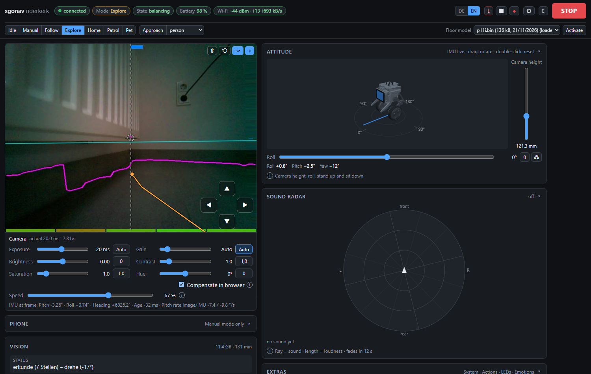
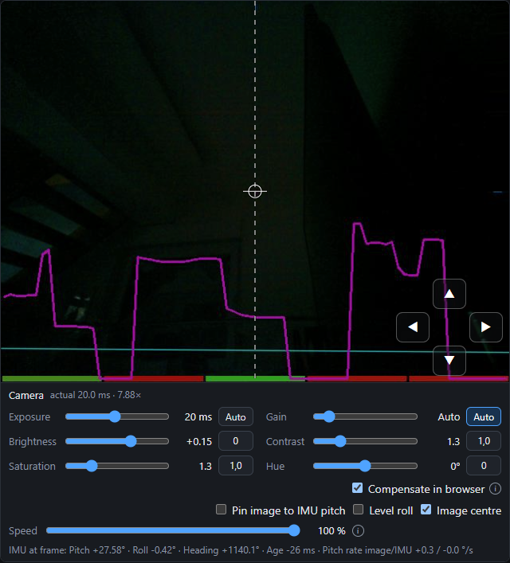
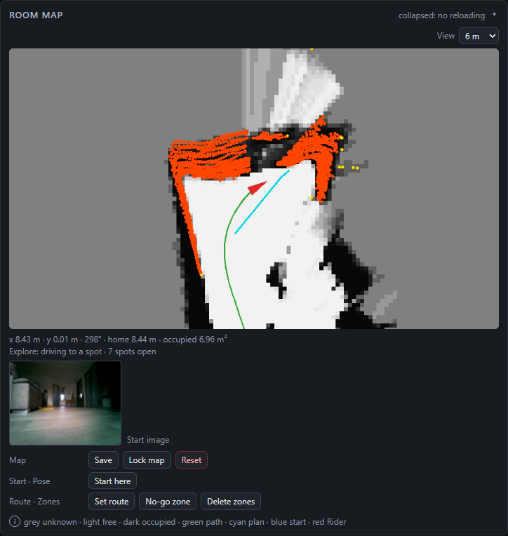
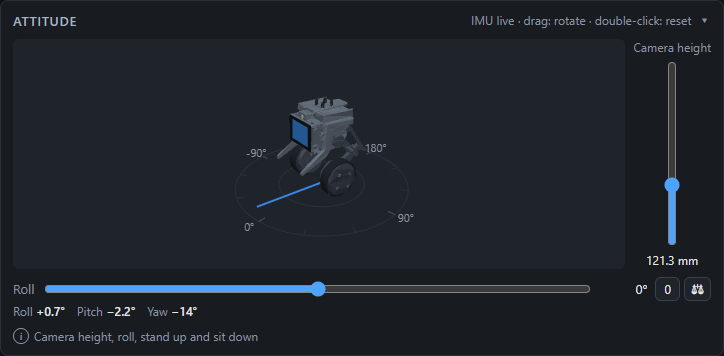
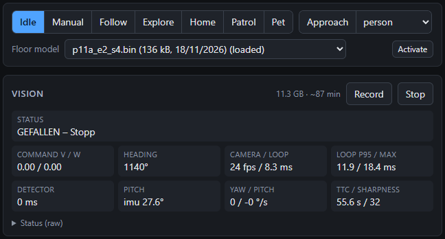
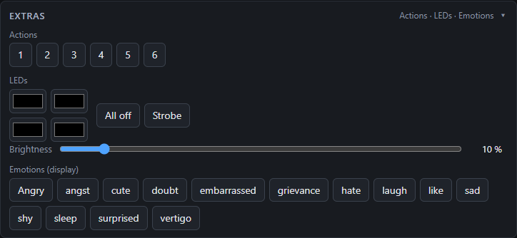
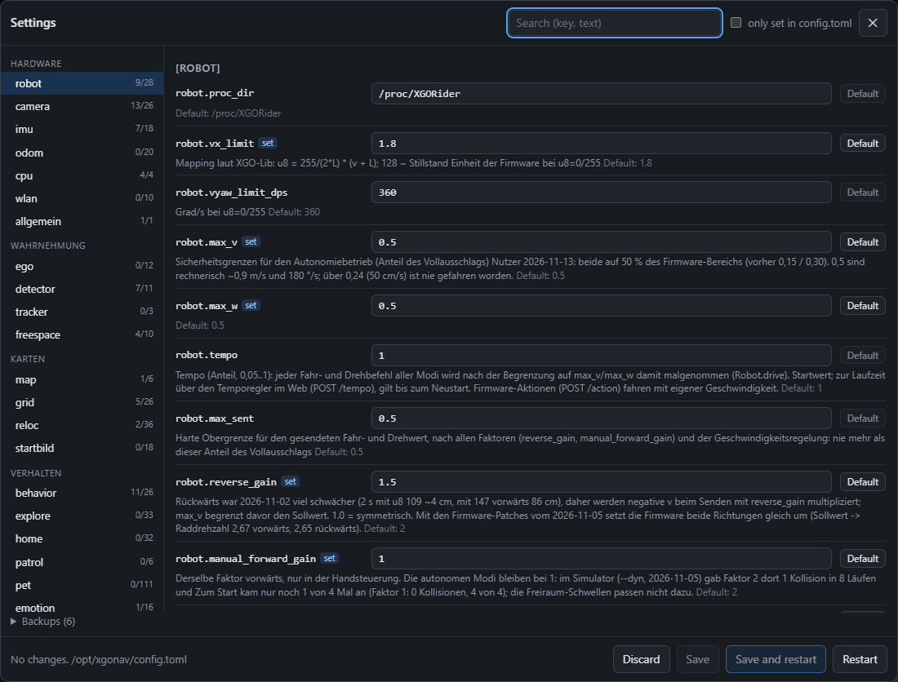
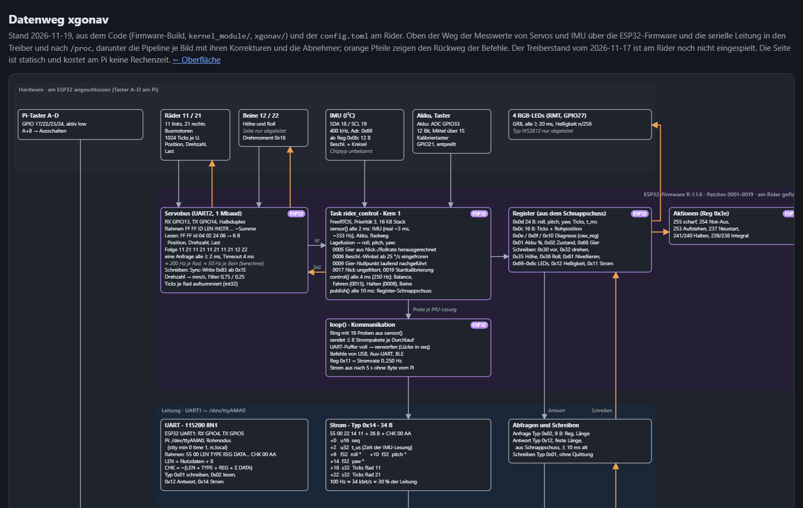
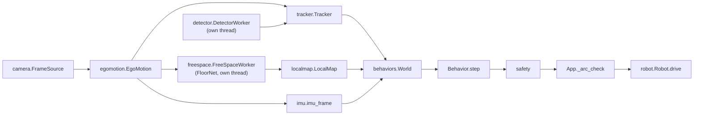

<div align="center">

# xgo_motorcortex2

**Camera navigation, kernel driver, firmware patches and web UI for the XGO RiderPi**

Self-balancing two-wheel robot · Raspberry Pi CM4 2 GB · OV5647 camera · ESP32 motor controller




<sub>Web UI on the Rider during <code>explore</code>: camera with floor boundary (magenta), horizon (cyan) and planned path (orange), 3D attitude, sound radar.</sub>

</div>

---

## Features

| | |
|---|---|
| **Floor boundary** | FloorNet, a self-trained floor segmentation network (C++ on the CM4, ~16 ms), the only obstacle source |
| **Ego-motion** | per-frame rotation homography from optical flow; IMU pitch/roll at frame time from the driver's IMU stream (~100 Hz) |
| **Maps** | short-term local map for the path check, occupancy room map (5 cm cells), wheel/IMU dead reckoning |
| **Behaviours** | `follow`, `approach`, `explore` (frontiers), `home`, `patrol`, `pet`, `manual` |
| **Safety layers** | `safety()` (fall, free space, TTC) → arc check against the local map → `Robot` clamp/ramp/watchdog → kernel watchdog |
| **Detector** | YOLO11n (NCNN, ONNX fallback); detections are targets only, never obstacles |
| **Audio** | sound direction from two microphones, sounds, phrase imitation in `pet` |
| **Interfaces** | PHP web UI (WebSockets), MCP server for multimodal LLMs, BLE service `RiderKerk` |
| **Low level** | kernel module `xgo-drv` (`/proc/XGORider/*`), ESP32 firmware patches, ST7789 display daemon |

CPU time on the CM4 comes first: hot paths run in a C++ core (`xgonav/native/`), display work runs in the browser.

## Screenshots

<table>
<tr>
<td width="50%"><br><sub><b>Camera</b>: floor boundary, horizon, path, free-space bars, ISP controls</sub></td>
<td width="50%"><br><sub><b>Room map</b>: free/occupied, driven path (green), plan (cyan), start image</sub></td>
</tr>
<tr>
<td><br><sub><b>Attitude</b>: live 3D model from the IMU, camera height, roll</sub></td>
<td><br><sub><b>Runtime info</b>: behaviour status, drive command, loop timing</sub></td>
</tr>
<tr>
<td><br><sub><b>Extras</b>: firmware actions, LEDs, display emotions</sub></td>
<td><br><sub><b>Settings</b>: <code>config.toml</code> editor with schema and backups</sub></td>
</tr>
</table>

<details>
<summary>Data-flow diagram (<code>web/schaubild.html</code>)</summary>



</details>

## Status

Single device, firmware R-1.1.6 + own patches. Details: [docs/limitations.md](docs/limitations.md).

| Item | On the Rider |
|---|---|
| Driver, IMU/wheel stream, display, web UI, manual driving | ✅ tested |
| `follow` | ✅ driven |
| FloorNet floor boundary | ✅ decides alone since 2026-11-10 |
| `explore` | ⚠️ three runs 2026-11-06, map not yet usable |
| `home` | ⚠️ does not reliably reach the start |
| `approach`, `pet` | 🧪 simulator and unit tests only |

## Architecture



Only the newest frame counts (no queues); the control step runs at `control_hz`. Web UI, LCD and recorder read an immutable per-frame `Snapshot`. More: [docs/architecture.md](docs/architecture.md).

## Repository

| Path | Content |
|---|---|
| `xgonav/` | Navigation pipeline (Python 3.11+, OpenCV, numpy, ncnn/onnxruntime); `native/` = C++ core |
| `kernel_module/`, `constants.h` | Kernel module `xgo-drv`, `/proc/XGORider/*` |
| `firmware/` | ESP32 firmware: reference (xgorider2_rl) + patches, built by `firmware/build.sh` |
| `st7789/` | Display daemon `st7789_server` (FIFO `/tmp/lcd0`, RGB565 320×240), based on libdriver/st7789 |
| `web/` | Web UI (PHP behind nginx), MCP server, HTML manual (`web/anleitung/`) |
| `deploy/` | Install scripts, systemd units, nginx/php-fpm/sudoers, `config.example.toml`, `rc.local`, `xgo-ble` |
| `tools/` | Calibration, model export, FloorNet training, map evaluation, nudge, BLE test |
| `tests/` | Unit tests, closed-loop simulator tests, `sim_run.py` |
| `driver-test/` | Driver code compiled in userspace against an ESP32 emulator |
| `docs/` | Per-topic documentation and manual sources |

Not included: TLS certificates/keys, YOLO and FloorNet models (gitignored).

## Quick start

<details open>
<summary><b>On the Rider</b></summary>

```bash
sudo ./deploy/install-all.sh            # driver, display, rc.local, xgonav -> /opt/xgonav, nginx + php-fpm, xgo-ble
sudo reboot                             # driver and rc.local take effect after reboot
sudo systemctl enable --now xgonav
```

Web UI: `https://<rider>/` (LAN only, no authentication). From the command line:

```bash
python -m xgonav --mode follow                    # follow a person
python -m xgonav --mode approach --target chair   # find and approach a chair
python -m xgonav --mode explore                   # map the room
python -m xgonav --mode home                      # back to the room-map start point
python -m xgonav --mode pet                       # reacts to people, cats, dogs; stays in place by default
python -m xgonav --mode idle --record debug.mp4   # watch only, record overlay
```

> [!WARNING]
> Never set body height below minimum + 10 mm. Move the real Rider only under observation.

</details>

<details>
<summary><b>On a PC (no hardware)</b></summary>

```bash
python3 -m venv .venv && .venv/bin/pip install "opencv-python-headless>=4.6" "numpy>=1.24" pytest "onnxruntime>=1.16"
.venv/bin/python -m pytest -q tests/                # 103 unit tests, ~2 s
.venv/bin/python -m pytest -q -m slow tests/        # 6 closed-loop simulator tests, ~10 min
.venv/bin/python tests/sim_run.py follow 40 out.mp4
.venv/bin/python tests/sim_run.py explore 300 --wheels --fs-thread --dyn --rider
```

</details>

## Documentation

HTML manual (install, quick start, web UI, behaviours, FloorNet training): `tools/build_manual.sh` builds `web/anleitung/` from `docs/` (MkDocs Material); on the Rider at `https://<rider>/anleitung/`.

| File | Topic |
|---|---|
| [architecture.md](docs/architecture.md) | Data flow, modules, threads, safety layers, conventions |
| [installation.md](docs/installation.md) | install-all, manual steps, nginx/php-fpm, permissions, model export |
| [configuration.md](docs/configuration.md) | TOML overrides, CLI flags, parameters per section |
| [calibration.md](docs/calibration.md) | FOV, turn rate, camera height/tilt, odometry, reverse gain |
| [driver.md](docs/driver.md) | `xgo-drv`, patches, `/proc/XGORider` reference, UART, driver test |
| [web-interface.md](docs/web-interface.md) | Web UI, `api.php`, xgonav local API, WebSocket protocol |
| [mcp.md](docs/mcp.md) | MCP server: camera, map, status and movement as tools for a multimodal LLM |
| [ble.md](docs/ble.md) | BLE service `RiderKerk`: frames, text console, tunnel to the Pi |
| [mapping.md](docs/mapping.md) | Odometry, local map, room map (occupancy grid) |
| [floornet.md](docs/floornet.md) | Self-trained floor network: field of view, labels, training, results |
| [display-emotions.md](docs/display-emotions.md) | LCD daemon, overlay, emotion player and triggers |
| [wifi-setup.md](docs/wifi-setup.md) | Wi-Fi without a network: hotspot `RiderKerk`, buttons C+D, QR code |
| [audio.md](docs/audio.md) | Sound card, speaker, microphones, sound direction |
| [testing.md](docs/testing.md) | Unit/slow tests, simulator, replay, results |
| [limitations.md](docs/limitations.md) | Hardware test status, measured values, known issues |
| [LED.md](docs/LED.md) | LED colours and patterns of firmware R-1.1.6 |
| [firmware/README.md](firmware/README.md) | ESP32 firmware build, patches, flashing rules |

Upstream driver: [aeinstein/xgo_motorcortex](https://github.com/aeinstein/xgo_motorcortex) (`c3c888c`).
