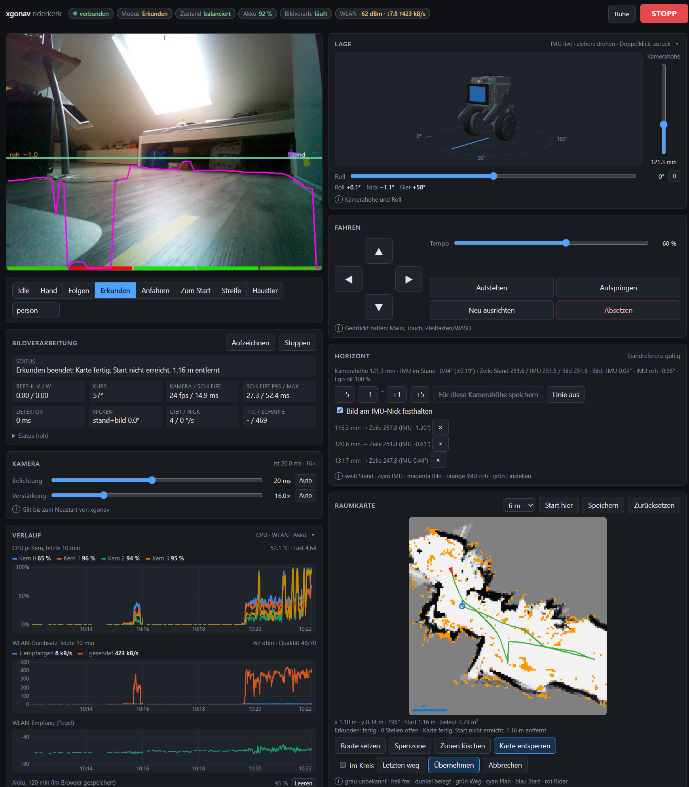

# xgo_motorcortex2

Kernel driver, display daemon, camera navigation (xgonav) and web UI for the XGO RiderPi
(self-balancing two-wheel robot, Raspberry Pi CM4 2 GB, OV5647 camera, ESP32 motor controller).

**Status:** single device, firmware R-1.1.6. Tested on the RiderPi: driver, IMU/wheel readout,
CPU time, camera geometry, manual driving (web UI), `follow` (runs 2026-11-02, `max_v` 0.15 ≈ 23 cm/s).
**Not tested on hardware:** `explore`, `approach`, `home`. Details: [docs/limitations.md](docs/limitations.md).



## Repository

| Path | Content |
|---|---|
| `kernel_module/`, `constants.h` | Kernel module `xgo-drv`, `/proc/XGORider/*` |
| `st7789/` | Display daemon `st7789_server` (FIFO `/tmp/lcd0`, RGB565 320×240), based on libdriver/st7789 |
| `xgonav/` | Navigation pipeline (Python 3.11+, OpenCV, numpy, ncnn/onnxruntime) |
| `tools/` | Calibration, model export, emotion player, raw replay, nudge |
| `tests/` | Unit tests, closed-loop simulator tests, `sim_run.py` |
| `web/` | Web UI (PHP, served by nginx) |
| `deploy/` | Install scripts, systemd units, nginx/php-fpm/sudoers config, `config.example.toml`, `rc.local` |
| `driver-test/` | Driver code compiled in userspace against an ESP32 emulator |
| `firmware/` | ESP32 firmware: fetch reference (xgorider2_rl), apply patches, build (`firmware/build.sh`) |
| `docs/` | Per-topic documentation |

Not included: legacy remote control `rc_server` (Node), TLS certificates/keys, YOLO models (`models/*_ncnn/`, `models/*.onnx`, gitignored).

## Quick start (on the Rider)

```
sudo ./deploy/install-all.sh            # driver, display, rc.local, xgonav -> /opt/xgonav, nginx + php-fpm
sudo reboot                             # driver and rc.local take effect after reboot
cd /opt/xgonav && venv/bin/python -m xgonav --config config.toml --mode idle
sudo systemctl enable --now xgonav      # as a service
```

Web UI: `https://<rider>/xgonav/`. No authentication; LAN only.

```
python -m xgonav --mode follow                    # follow a person
python -m xgonav --mode approach --target chair   # find and approach a chair
python -m xgonav --mode explore
python -m xgonav --mode home                      # back to the room-map start point
python -m xgonav --mode idle --record debug.mp4   # watch only, record overlay
```

Stop `rc-control.service` while xgonav drives. Never set body height below minimum + 10 mm.

## Quick start (PC, no hardware)

```
python3 -m venv .venv && .venv/bin/pip install "opencv-python-headless>=4.6" "numpy>=1.24" pytest "onnxruntime>=1.16"
.venv/bin/python -m pytest -q tests/                # 49 unit tests, ~2 s
.venv/bin/python -m pytest -q -m slow tests/        # 3 closed-loop tests, ~90 s
.venv/bin/python tests/sim_run.py follow 40 out.mp4
```

## Documentation

| File | Topic |
|---|---|
| [architecture.md](docs/architecture.md) | Data flow, modules, threads, safety layers, conventions |
| [installation.md](docs/installation.md) | install-all, manual steps, nginx/php-fpm, permissions, model export |
| [configuration.md](docs/configuration.md) | TOML overrides, CLI flags, parameters per section |
| [calibration.md](docs/calibration.md) | FOV, turn rate, camera height/tilt, lens shading, odometry, reverse gain |
| [driver.md](docs/driver.md) | `xgo-drv`, patches, `/proc/XGORider` reference, UART, driver test |
| [web-interface.md](docs/web-interface.md) | Web UI, `api.php`, xgonav local API, WebSocket protocol |
| [mapping.md](docs/mapping.md) | Odometry, short-term local map, room map (occupancy grid) |
| [display-emotions.md](docs/display-emotions.md) | LCD daemon, overlay, emotion player and triggers |
| [testing.md](docs/testing.md) | Unit/slow tests, simulator, replay, results |
| [limitations.md](docs/limitations.md) | Hardware test status, measured values, known issues |
| [firmware/README.md](firmware/README.md) | ESP32 firmware build, patches, flashing rules |
| [LED.md](docs/LED.md) | LED colours and patterns of firmware R-1.1.6 |

Upstream driver: [aeinstein/xgo_motorcortex](https://github.com/aeinstein/xgo_motorcortex) (`c3c888c`).
