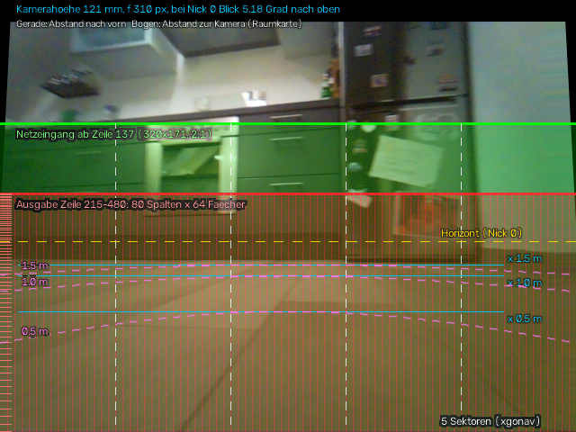

# FloorNet

Self-trained network for the floor boundary, one row per image column. **Status: the only floor boundary; decides alone on the RiderPi since 2026-11-10 and drives with it.** Without the network (file or C++ core missing, self-test or runtime failure) the Rider is blind and does not drive by itself (`docs/configuration.md`).

## Network

| Item | Value |
|---|---|
| Input | 640×480 BGR, rows 137–478, 2:1 average → 320×171 |
| Structure | 3×3 stem, 6 depthwise-separable blocks, rows collapsed, column head (1×1, 1×3, 1×1) |
| Output | 80 columns (8 px each), 64 row bins each over rows 215–480 (up to p11h: 205–480): 1.4 px at the top, about 9 px at the bottom; best bin refined with a parabola |
| Bin range per net | `row_top` in the run's `netz.json` (missing = 205, runs up to p11h); every `.bin` carries its own bin centres, so the Rider decodes old and new nets correctly |
| When | only while balancing; lying or set down there is no boundary and the net is not run. Pitch in training: `train.py --nick_korr 5` removes the measured pitch (up to 5°) per frame, `--nick_zufall 5` adds random ±5°, `--roll 3` random ±3° roll about the image centre; image and label move together (`geom_shift`, test `test_geom_shift_bild_und_label_passen`) |
| Size | 30 k parameters, 17.8 MMACs (`f2_s` in `bench_kern.cpp`) |
| Time, untrained, CM4 next to YOLO at 12 Hz | 13.6 ms mean, 17.3 ms p95; YOLO 119 → 136 ms |
| Inference | C++ with NEON (`xgonav/native/floornet.cpp`, `floornet_kern.h`), float32, no framework, self-test at load |

Field of view: `tools/floornet/sichtfeld.py` writes two RGBA masks (640×480) to lay over any undistorted input
image; `--bild a.jpg --out b.png` makes a preview, `--meta <run>/meta.jsonl` (or `--nick`/`--roll` in degrees) first
rotates the frame to pitch 0 and roll 0 (homography about the image centre), so the drawn horizon meets the real one.
Regenerate after changing `net.py` or the camera geometry.

Pitch sign: `pitch_dev` 0 means IMU pitch = `pitch_ref_deg` (−5.0°); there the camera looks `tilt_deg` (5.18°) up,
so the horizon lies 28 rows below the centre. Only the sum matters: at IMU pitch 0 the camera is level (0.18°).
While driving `pitch_dev` is typically −2 to −4°, so the horizon sits at rows ~245–256 in raw frames.

| Mask | Shows |
|---|---|
| `img/floornet_maske.png` | green: network input rows 137–478; red over it: output range rows 215–480 (nets from p11i; up to p11h 205), so the mixed colour is input and output, pure green is input only (context); output with 80 column lines and the 64 bin edges as a scale on the left; white dashed: the 5 `freespace.sectors` |
| `img/floornet_maske_entfernung.png` | nominal (pitch 0, cruise height, camera 121 mm): horizon (row 268) and floor distances 0.5 / 1.0 / 1.5 m: straight lines = forward distance (rows 346 / 306 / 294), dashed arcs = distance from the camera along the bearing (1.44× the forward distance at the image edge; `grid.max_range_m` and `free_range_m` count this way since 2026-11-23) |
| `img/floornet_beispiel1.png`, `img/floornet_beispiel2.png` | both masks over a kitchen (tiles, ride 20261122-202716 frame 029299, pitch −2.9°, roll 0.0°) and a living room (carpet, ride 20261123-130232 frame 004023, pitch −1.1°, roll +0.4°) frame, each rotated to pitch 0 / roll 0 first; black border = outside the original frame |



Constraints from the kernel: no ReLU and no bias after the depthwise convolution, residual before the ReLU of the 1×1 layer, 1×1 output channels divisible by 8. BatchNorm exists only in training; `net.fold` folds it into the weights.

## Files

| File | Purpose |
|---|---|
| `tools/floornet/comfy_batch.py`, `comfy_prompt*.txt` | ComfyUI (Qwen-Image-Edit paints the floor green) over many frames, stage 1; see below |
| `tools/floornet/ids_fahrt.py` | frame list of raw recordings for `comfy_batch.py --ids`: every n-th frame, standing frames dropped |
| `tools/floornet/stage2.py`, `inseln.py` | green edits → masks (stage 1 → 2, `floor_mask`, `--gruen` for the green lead); count and show islands and holes in masks, changes nothing |
| `tools/floornet/stage3.py` | stage 2 → 3: per pixel column only what is unbroken from the bottom edge; no islands or holes remain |
| `tools/floornet/stage3_npz.py` | stage 3 → label files for `train.py`: one row per 8 px strip (majority), filters as `comfy_npz.py`; frames from `--data/<run>`, camera geometry (only for metres in evaluation and distance weights) from `--config` (Rider TOML), camera height from `height_mm` in `meta.jsonl`; `--gesichtet` keeps only frames the user has seen |
| `tools/floornet/comfy_npz.py` | label building shared with `stage3_npz.py`; drops frames lying down, tilting (> 10 % of columns above row 215, `ROW_MIN` = `net.ROW_TOP`), torn masks (> 6 jumps > 40 px), dark (mean grey < 12) |
| sorting out (from stage 2 on) | nothing is deleted. Standing frames: pose in `meta.jsonl` less than 3 cm and 3° from the last kept frame (`stage2.py --steht_m --steht_grad`, 0 = off). Unusable frames: `<stage1>/aus_hand.txt`, one id per line, `-id` restores, written by the viewer. Rules travel in `info.json` of stage 2 and 3; `index.js` (`BILDER`, `AUS`), `stage3.py` and `stage3_npz.py` apply them |
| `tools/floornet/betrachter.html`, `betrachter_server.py` | original, stage 1–3 side by side, arrow keys step through frames; list from `<stage>/index.js`. `X`/button marks the frame unusable (or restores it), `A` shows sorted-out frames too. Every frame shown is appended to `<stage1>/gesichtet.txt` (`POST /gesichtet`) and hidden after the next reload; `G` shows them again. Space starts/stops a run that advances as fast as frames are completely loaded. Served from `~/floornet` by `betrachter_server.py` (static files + `POST /aus`, port 8765, home network only, no auth) |
| `tools/floornet/netz_betrachter.html` | net result per frame (`netz_js.py`, `fahrt_js.py`). Lists with `label` and `ansicht` also show the label line (green) and the ComfyUI edit; `X`/`U` write the same list of unusable frames as `betrachter.html`, every frame shown counts as seen, lists with `sichten` hide seen frames after reload (`G` shows them). `N` repaints the frame (`POST /neu`), `1`–`3` pick the prompt variant (default T1). `H` draws the label line by hand (drag in the net image, below the edge = no floor; `M` takes the net line, `Ctrl+Z` undo, `Enter` save via `POST /hand`, `Esc` discard) |
| `tools/floornet/neu_malen.py` | one frame through ComfyUI again with a random seed and a prompt variant (`--prompt 11\|t1\|t2`, a new variant = a new `comfy_prompt*.txt`); **overwrites** the stage 1 edit and its stage 2/3 masks, logs seed, prompt and label row to `<stage1>/neu.jsonl`. Called by `betrachter_server.py --python <venv python>` on `POST /neu`, one at a time. `--hand` (line of 80 rows on stdin, `POST /hand`) writes a hand-drawn line as stage 2/3 masks instead, stage 1 stays; logged as `"hand": true`, the last line per frame wins |
| `tools/floornet/nick_bezug.py` | `pitch_dev` of firmware-0021 runs re-referenced to `pitch_ref_deg` −5.0; used by `comfy_npz.py`, `geo_label.py`, `abstimmen.py`, `fahrt_js.py`, `tools/map_replay.py`. Affects metres only (evaluation, near-frame selection), not the learned rows |
| `tools/floornet/schnitt.py` | time window of a recording as its own run |
| `tools/floornet/geo_label.py` | labels from geometry instead of ComfyUI (probe, not used for training); see below |
| `tools/floornet/net.py`, `train.py` | network, folding, training (GPU) |
| `tools/floornet/eval_labels.py` | net against stage 3 labels of test runs, falsely free / falsely blocked per distance band and under 1 m |
| `tools/floornet/netz_js.py`, `fahrt_js.py` | net output per frame for `netz_betrachter.html` |
| `tools/floornet/export.py` | weights, bin centres and test vector for the C++ core (`models/floornet/<name>.bin`) |
| `tools/floornet/sichtfeld.py` | field-of-view masks, see above |
| `tools/floornet/bench_kern.cpp` | timing of untrained variants on the CM4 |
| `xgonav/floornet.py` | ctypes wrapper; off if the core is missing or the self-test fails |
| `tests/neon_shim/arm_neon.h` | the NEON intrinsics as plain C++, so `tests/test_floornet_native.py` runs without ARM (result only, not speed) |

## Workflow

On kimmy (`~/floornet`), after new runs went through ComfyUI and were looked at in the viewer:

```
cd tools/floornet
python stage2.py ~/floornet/stage1_p11 ~/floornet/stage2_p11 --gruen 30 --jobs 4
python stage3.py ~/floornet/stage2_p11 ~/floornet/stage3_p11
python stage3_npz.py ~/floornet/stage3_p11 --config rider.toml --out labels/ --jobs 8 \
    --gesichtet ~/floornet/stage1_p11/gesichtet.txt --fahrten <dated runs>
python train.py --labels labels/ --out run/ --train <runs> --val "" --dist 0.005 --yaw 0.5 --epochs 200 --lr 1.5e-3 \
    --far_w 2 --smooth_w 2 --seed 1 [--nick_korr 5 --nick_zufall 5 --roll 3]
python eval_labels.py run/ --labels ~/floornet/stage3_p11d_pruef --fahrten explore10,explore11,explore12
python export.py run/floornet.pt --out models/floornet_<name>.bin
```

Only runs the user has looked at go into training. Test runs are never trained: explore10–12 (final test), streife1 + unten*, explore2–9. Training (200 epochs, ~36 k frames) takes about 9 minutes on the GPU; one seed varies by about ±1–3 points under 1 m.

On the Rider `models/floornet.bin` is a symlink into `models/floornet/` (`[freespace] net_dir`); copy further nets there as `<name>.bin` (`.tmp` + `mv`, never `cp` onto the symlink) and pick one in the web (*Bodenmodell*, idle/manual only, no restart; cost on the Pi: one load + self-test on demand, nothing per frame except an uncontended lock around the inference). `deploy/install.sh` copies new and changed files from `models/floornet/`.

Spike removal in the decoder (`[freespace] net_outlier_px`, default 25, 0 = off; `net.decode(logits, outlier_px, outlier_ratio)` in PyTorch, `decode` in `native/floornet.cpp`, both tested against each other): the raw output has 1–3 column wide jumps at vertical high-contrast edges, the output there is bimodal. A column further than `net_outlier_px` rows from the median of the 7 columns around it takes the best bin within ±2 bins of that median, if the probability mass there (5 bins) is at least `net_outlier_ratio` (0.3) of the mass at its own peak. Columns without a second peak keep their value (narrow obstacles). Cost on the Rider: a 7-value median per column, `exp` only in outlier columns.

| explore10–12 (never trained), 4551 frames | < 1 m falsely free / blocked | frames with spike down / up |
|---|---|---|
| plain decode | 5.4 / 6.2 % | 6.1 / 2.1 % |
| spike removal | 5.4 / 5.8 % | 1.0 / 0.6 % |

Spike = column more than 25 rows from the 7-column median; the count includes real narrow obstacles. Measured 2026-11-10 against stage 3 labels.

## Results (stage 3 p11 labels)

Under 1 m against `stage3_p11d_pruef`, falsely free / falsely blocked, one seed each:

| Net | explore10–12 | streife1 + unten* | explore2–9 |
|---|---|---|---|
| p11e_e2 | 8.6 / 7.2 % | 11.3 / 3.5 % | 8.5 / 6.9 % |
| p11f (33 252 frames) | 10.4 / 5.9 % | 8.6 / 3.4 % | 8.5 / 6.0 % |
| p11g (36 270 frames, lr 1.5e-3, 200 epochs) | 8.9 / 7.3 % | 8.0 / 3.2 % | 7.5 / 6.9 % |
| p11h (as p11g, lr 7.5e-4, 400 epochs) | 9.1 / 7.2 % | 7.1 / 3.3 % | 8.4 / 6.7 % |
| p11i (as p11g, bins from row 215) | 9.8 / 5.7 % | 6.9 / 3.4 % | 7.1 / 6.6 % |
| p11j (as p11i, `--nick_korr 5 --nick_zufall 5 --roll 3`) | 8.8 / 7.5 % | 6.0 / 4.2 % | 6.0 / 7.4 % |

## Cost on the Rider

Measured with the network of 2026-11-06; the current one has the same structure. CM4 against PyTorch on 30 real frames: at most 0.0003 rows apart; self-test 4.8e-06.

| Measurement | Without network | With network |
|---|---|---|
| Idle, 24 fps: main loop mean / p95 | 8.1 / 14.1 ms | 9.8 / 15.8 ms |
| Idle: YOLO, CPU of xgonav | 120 ms, 154 % | 136 ms, 178 % |
| Idle: network | | 14.9 ms (moving average) |
| `explore` with raw recording, median / p90 | loop 16.6 / 31.8 ms, YOLO 133 ms (`unten1`) | loop 23.1 / 52.6 ms, YOLO 171 ms, network 20.4 / 29.4 ms (`unten3`) |

The drive rows come from different scenes and light; they are not a clean comparison. The plan goal p95 < 15 ms is missed while driving.

## Smoothing over time (2026-11-11)

`[freespace] net_smooth_n` (`xgonav/floornet.py`, `ZeilenGlaetter`; 3 on the Rider): the last n network outputs are mapped onto the current frame through the floor plane (map pose, pitch), the median per column counts. No retraining, numpy on n × 80 values. Measured with `tools/floornet/glaetten_eval.py` on explore10–12 (4 551 frames, every second camera frame, network `lauf_stage3`, stage 3 labels of prompt 10):

| Variant | Jumps > 20 rows to the previous frame | Median jump | < 1 m falsely free | < 1 m falsely blocked |
|---|---|---|---|---|
| raw | 1.12 % | 0.6 rows | 6.20 % | 4.85 % |
| n = 3 | 0.61 % | 0.2 rows | 6.40 % | 4.63 % |
| n = 5 | 0.51 % | 0.2 rows | 6.68 % | 4.48 % |

The rise of "falsely free" comes almost only from explore10 (0.5–1 m: 13.1 → 14.7 → 16.1 %). Persistent errors stay; it only removes outliers in time.

## Labels from ComfyUI

ComfyUI on kimmy (service `comfyui`, ~29 GB VRAM next to LM Studio) has only image generation and editing models, no segmentation or depth. Qwen-Image-Edit 2511 with the 4-step Lightning LoRA recolours the floor green; the green mask gives the boundary per column (lowest run of floor from the bottom, gaps up to 6 rows bridged). 3.6 s per frame, first load 2.5 min.

```
python comfy_batch.py --prompt prompt_standard.txt --ids ids.txt --edits <stage1> --out <stage1>
```

`comfy_batch.py` keeps every edit (`<edits>/<run>/<frame>.png`), so masks can be recomputed without the model. Seed fixed (`SEED` = 1); repaints in the viewer use a random seed.

| Prompt | Use |
|---|---|
| T1 (`comfy/prompte/t1.txt`, `prompt_standard.txt` links to it) | standard since 2026-11-20 (rug set) |
| 11 (`comfy_prompt11.txt`) | all runs up to lauf21 (run 20261120-115634): only the bare floor surface is recoloured, rugs and things on the floor stay unchanged |
| 10 (`comfy_prompt10.txt`) | before 2026-11-11; painted rugs and things lying on the floor green |

Input and mask: `--eingang g0h` for dark frames (green channel 0, larger of R and B set to the grey value; colour kept for rugs, dark green-tinted frames not black), mask with hue and saturation and green lead G − max(R, B) ≥ 30 (`stage2.py --gruen 30`), then `stage3.py`. The green channel alone (G > 0) fails: the image decoder leaves small green values on unpainted pixels. Low thresholds count the faint green shimmer the model adds to walls next to the floor (`unten2/002400`: walls up to 48, floor from 170). `floor_mask` requires V ≥ 30: below that the hue is noise, above it floor painted dark green in shadow counted as blocked.

| Prompt rule | Finding |
|---|---|
| "recolour the floor, add nothing" | reflections and lamp glare become floor |
| naming rugs or "a small robot" | the model paints them into the frame (robot in ~50 % of frames): never name what should not appear |
| floor under furniture only where the gap is higher than 18 cm | far fewer columns running under sofas, chair bases and low shelves |
| baseboards and skirting tiles are wall | tile skirting of the same material is no longer painted |
| floor ends at the front edge of sofa / chair base | no gain on 60 frames, worse on random ones: dropped |

Known teacher errors: a tile-clad step riser seen from close by is painted as floor, as is floor visible under an overhanging sofa. These labels are no fall or step protection. The network is weakest directly in front of plain walls filling the frame (columns jump).

Brightening (2026-11-19, `aufhellen.py`): `--aufhellen S` runs Zero-DCE (DCE-Net from keras-io/low-light-image-enhancement, ported to torch, weights `~/floornet/comfy/zerodce.npz` on kimmy, not in the repo) on dark frames (brightness < `--hell_ab`) before the chain; curve step scaled by `S` (1 = Keras example, which lifted mean grey ~63 → 188 and was judged too strong; 0.5 → ~128, 0.25 → ~94). `--dunkel farbe|g0h` picks the chain for dark frames. Not used: no frame better than without. Moss-Image-Edit instead of Qwen: no frame better than the Qwen green image (user, 40 probe frames).

## Labels from geometry (probe 2026-11-18)

**Decision 2026-11-20: not adopted.** Judged on the images, the stage 3 p11 labels (Qwen green image) are better than every geometry teacher (MoGe-2, all DA3 variants); training labels stay on the p11 pipeline.

`tools/floornet/geo_label.py`, model `Ruicheng/moge-2-vitl-normal` (MIT, 331 M parameters; `pip install git+https://github.com/microsoft/MoGe.git`).

| Step | Rule |
|---|---|
| Points | MoGe-2 with `fov_x = hfov_deg`, principal point at the image centre (matches `CamGeometry`) |
| Plane | RANSAC (256 planes from 3 points) on points below the IMU horizon + 15 rows; only planes within 8° of the IMU pitch and with distance 0.6–3.0 × `cam_h` in model units (MoGe puts the Rider camera 1.2–1.7× too high); refined 3× by smallest eigenvector of inliers (tolerance 10 % of `cam_h`) |
| Scale | everything scaled so the plane lies exactly `cam_h` below the camera; fewer than 2000 inliers → median scale of the run so far, IMU pitch (`art` `ersatz`), shown in the images only and dropped from the label file |
| Pixel class | floor h ≤ 2.5 cm, including everything below the plane (no drop class, user decision); obstacle 2.5 cm < h < 18 cm; above 18 cm ignored (table, high sofa) |
| Row per strip | free floor from the bottom (majority per 8 px strip, gaps ≤ 6 rows, same as `mask_rows`); if the 16th-nearest obstacle pixel of the strip is nearer, the row where the floor has that forward distance (foot point under a low sofa edge) |

Per frame on kimmy: model 80 ms at batch 8 (9.9 GB VRAM), CPU 12 ms in threads (`--jobs`) next to the GPU; ~13 frames/s overall.

| explore10–12 vs. stage 3 p11 (1384 frames, `skala_hi` 3.0, 2.4 % `ersatz`) | median abs. diff | geometry > 15 cm freer | > 15 cm tighter |
|---|---|---|---|
| 0–0.5 m | 2 cm | 7 % | 9 % |
| 0.5–1.0 m | 6 cm | 7 % | 16 % |
| 1.0–1.5 m | 13 cm | 12 % | 32 % |
| 1.5–2.5 m | 31 cm | 20 % | 55 % |

```
python tools/floornet/geo_label.py fahrten --runs explore10,explore11,explore12 --jedes 2 --config rider.toml --out geo_lab
```

| Known gap | Effect |
|---|---|
| Rugs | geometrically floor, for the Rider an obstacle: false free on rugs |
| Step down | counted as floor (no drop class): geometry labels never block a downward step |
| Scale | camera height 121–150 mm is unusual for MoGe; only the plane fit sets the scale |

Tests: `tests/test_floornet_geo.py` (rendered point maps: wall, box, low sofa edge, table, step down, pitch error, scale error, holes; with a fake model; depth maps via `--tiefe`).

### Depth Anything 3 instead of MoGe (probe 2026-11-20)

`tools/floornet/da3_tiefe.py` (own venv `~/floornet/da3/.venv` on kimmy, DA3 needs numpy < 2) writes depth + conf per frame; `geo_label.py --tiefe DIR` builds the point map from it with the Rider `f` and image centre. DA3 depth is relative, so `--skala_lo 0.2 --skala_hi 5`. Comparison page: `tools/floornet/da3_seite.py` → `~/floornet/da3/index.html` (port 8765, `/da3/`).

| Variant | Licence | GPU per frame | Own plane (of 1384) |
|---|---|---|---|
| MoGe-2 (for reference) | MIT | 80 ms | 1351 |
| `DA3METRIC-LARGE`, single | Apache 2.0 | 50 ms | 1165 |
| `DA3-LARGE-1.1`, single | CC BY-NC 4.0 | 58 ms | 1322 |
| `DA3-LARGE-1.1`, windows of 8 consecutive frames | CC BY-NC 4.0 | 37 ms | 1098 |

vs. stage 3 p11 on the 940 frames where all have an own plane (> 15 cm freer / tighter than p11), all with `--entzerrt 1`:

| Band | MoGe-2 | metric | L-1.1 single | L-1.1 window 8 |
|---|---|---|---|---|
| 0–0.5 m | 3.3 / 4.7 % | 2.4 / 2.5 % | 3.3 / 0.6 % | 2.5 / 0.0 % |
| 0.5–1.0 m | 6.7 / 11.3 % | 8.9 / 9.9 % | 5.0 / 6.4 % | 8.3 / 7.6 % |
| 1.0–1.5 m | 12.0 / 27.9 % | 31.0 / 17.5 % | 5.6 / 28.8 % | 12.4 / 27.4 % |
| 1.5–2.5 m | 19.9 / 52.1 % | 47.9 / 33.1 % | 9.1 / 57.7 % | 17.1 / 55.8 % |

Filled border of the lens table (`--entzerrt`, default 1): pixels whose source lies outside the camera image (`camera.lens_source`; right edge 24–26 px at floor-line height, 13 px at the bottom, plus the bottom ~10 rows of the right half) are left out of the plane fit; strips whose centre below the horizon is mostly filled take the row of the nearest real strip (line continues flat), widened by one strip inwards (MoGe kinks ~8 px before the filled border, explore10/008606). MoGe tighter than p11: 0–0.5 m 10.3 → 4.7 → 0.8 %, 0.5–1.0 m 11.3 → 7.4 %; DA3 unchanged.

Bent-up near floor (`rand_rampe`, `--rand`, default 1): DA3 sometimes lifts the floor near the bottom edge (explore11/010011: h 0 → 9 cm over the bottom 100 rows), the band turns obstacle and the line drops to row 480. Per strip, an obstacle band touching the bottom counts as floor if at least `min_px` rows of floor follow directly above it and the band rises towards the bottom (bottom quarter > top quarter + 1 mm). A flat box top at the edge stays obstacle. 010011: row 480 → 303–324; totals unchanged (DA3-L-1.1 below 1 m 5.0 % freer / 5.7 % tighter).

Windows of 8 do not make the line steadier from frame to frame (median change 4.6 vs. 5.0 cm single, p11 5.1 cm) and lose planes. explore10 stays ~29 % freer than p11 below 1 m for every geometry teacher (rugs).
