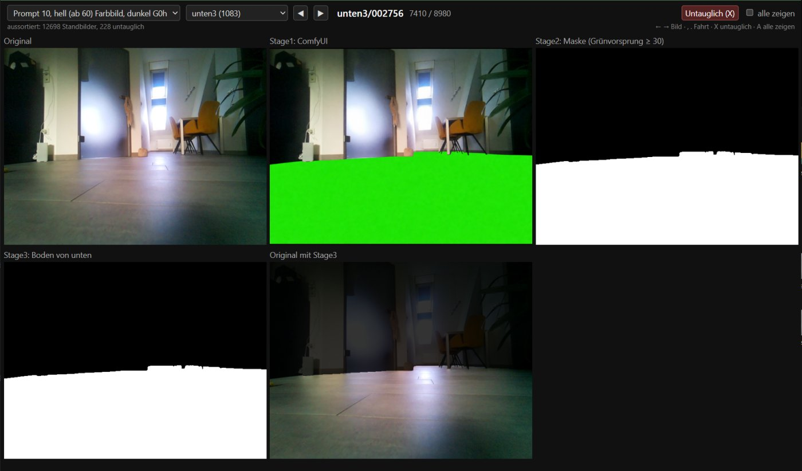

# FloorNet training

FloorNet is the self-trained network that finds the floor boundary (one row per 8 px column). It is the **only** floor boundary: without it the Rider is blind.
Runs on the Rider in C++ with NEON (~14 ms per frame); training runs on a GPU machine. Full reference: [FloorNet](../../floornet.md).

## Pipeline

| # | Step | Where |
|---|---|---|
| 1 | raw recording | Rider (web UI) |
| 2 | frame list, ComfyUI paints the floor green (stage 1) | GPU machine |
| 3 | mask (stage 2), floor from the bottom (stage 3) | GPU machine |
| 4 | review in the viewer, mark bad frames | browser |
| 5 | labels, training, export to `.bin` | GPU machine |
| 6 | copy to `models/floornet/`, pick in the web UI | Rider |

## 1. Record

Web UI → *Pipeline* → **Aufzeichnen**, then drive by hand. Writes JPEG + `meta.jsonl` (pose, IMU, wheels, height, camera settings) per frame to `~/fahrt/YYYYMMDD-HHMMSS` while balancing; setting down closes the run.
Drive slowly, vary distance to walls, furniture and rugs, bright and dark rooms.

## 2. Labels (GPU machine)

```bash
python tools/floornet/ids_fahrt.py 20261110-201720 --jedes 2 >> comfy/ids.txt     # frame list, standing frames dropped
python tools/floornet/comfy_batch.py --prompt tools/floornet/comfy_prompt11.txt --ids comfy/ids.txt \
    --edits stage1_p11 --nur_edits --eingang auto --out stage1_p11                # Qwen-Image-Edit paints the floor #00FF00
python tools/floornet/stage2.py stage1_p11 stage2_p11 --steht_m 0.03 --steht_grad 3  # green lead ≥ 30 → mask
python tools/floornet/stage3.py stage2_p11 stage3_p11                              # per column: floor unbroken from the bottom
```

| Stage | Content |
|---|---|
| 1 | ComfyUI edit (bright frames in colour, dark frames as G0h); edits are kept forever, seed fixed |
| 2 | binary mask from hue, saturation, green lead |
| 3 | per pixel column only the floor connected to the bottom edge: no islands, no holes |

Prompt rules that matter: never name what should not appear (the model paints it), rugs are obstacles, floor under furniture only where an 18 cm Rider fits.

## 3. Review



`tools/floornet/betrachter.html` (served by `betrachter_server.py`, port 8765, home network only) shows original, stage 1–3 side by side. Arrow keys step, **X** marks a frame unusable, **A** shows sorted-out frames. Only reviewed runs go into training.

## 4. Train and export

```bash
python tools/floornet/stage3_npz.py stage3_p11 --config rider.toml --out stage3_p11_labels
python tools/floornet/train.py --labels stage3_p11_labels --out lauf/ --train <runs> --val <runs>
python tools/floornet/export.py lauf/floornet.pt --out models/floornet/<name>.bin
```

Training takes about a minute on the GPU. Keep check runs (never trained) apart: a run in training cannot test the same network. Measure with `tools/floornet/eval_labels.py`.

## 5. Deploy

```bash
scp models/floornet/<name>.bin root@<rider>:/opt/xgonav/models/floornet/
```

Web UI → *Bodenmodell* → pick → **Aktivieren** (idle / manual only, no restart). `models/floornet.bin` on the Rider is a symlink: never `cp` onto it.
The net runs a self-test at load; on failure the Rider is blind and says so in the log.
