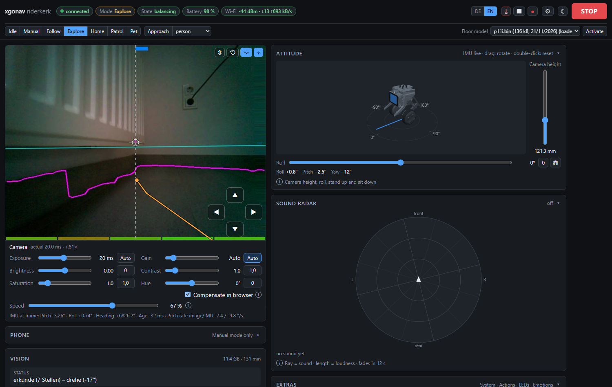
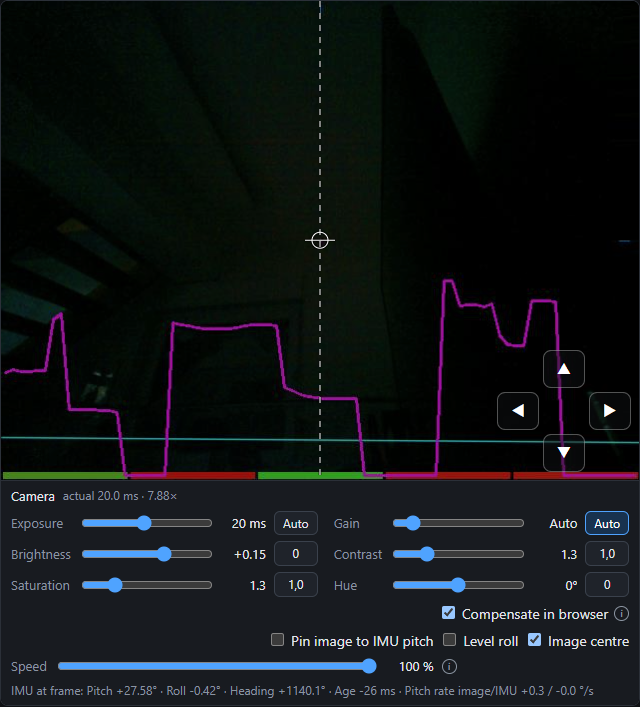
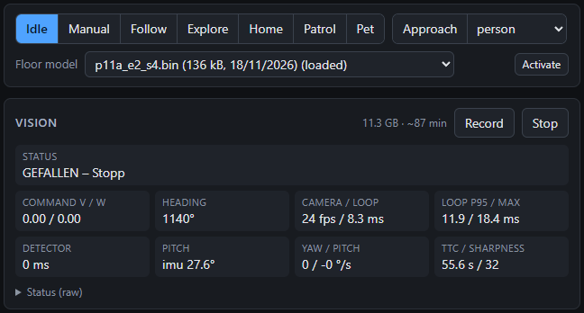
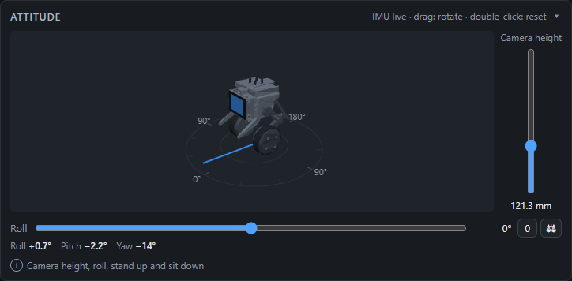
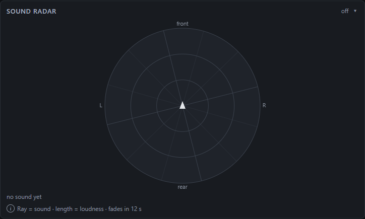
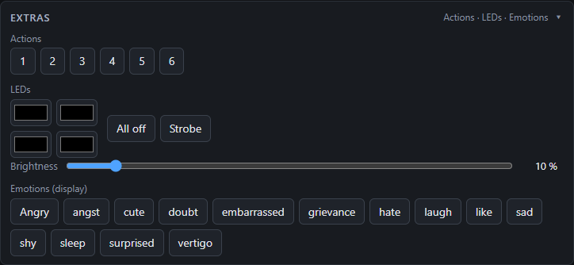
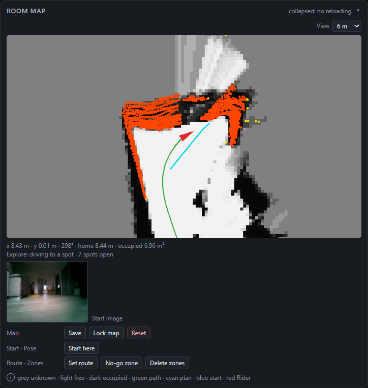
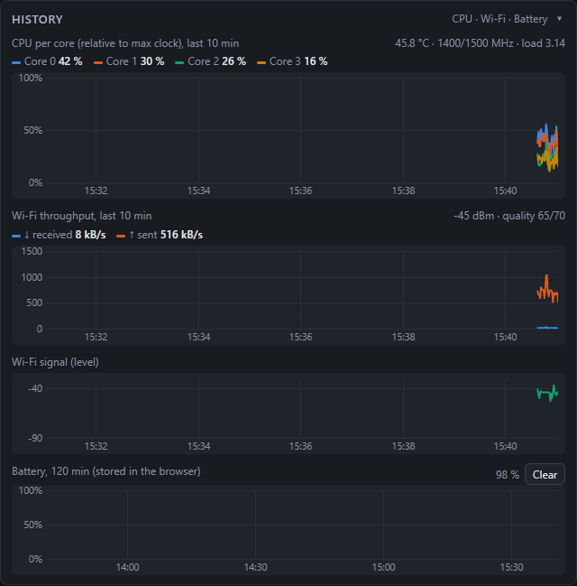
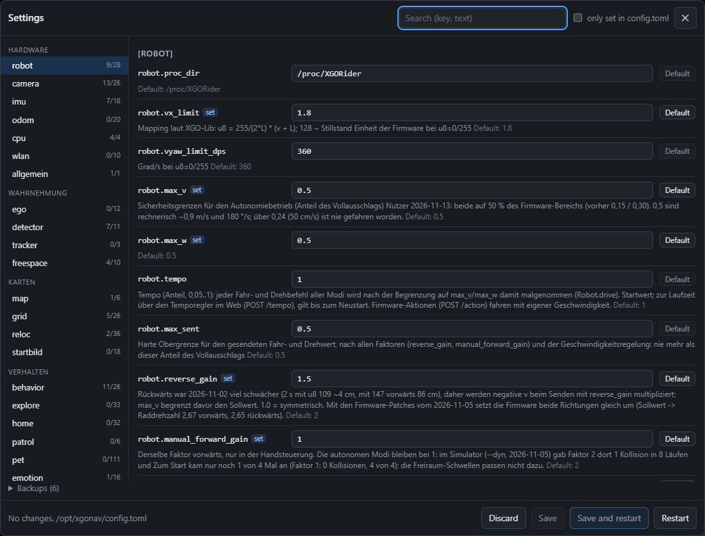
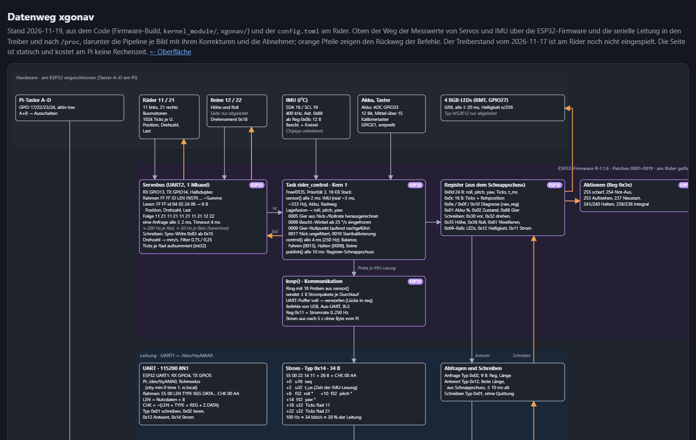

# Web UI

`https://<rider>/` – nginx + PHP on the Rider, live data over WebSockets. Everything shown here is drawn in the browser; the Rider only sends JPEG frames and status. The UI is German by default, **EN** in the header switches it; the screenshots show the English labels with the German ones in brackets. Full reference with every control: [Web interface](../web-interface.md).

## Header

| Item | Meaning |
|---|---|
| Pills | connection, mode, state (balancing / lying), battery (green ≥ 40 %, yellow ≥ 20 %, red below), recording, Wi-Fi (dBm, ↓/↑ kB/s) |
| DE / EN | UI language (browser only) |
| ⤓ Sit down (Absetzen) | set down (254); shown only while balancing |
| ⤒ Jump up (Aufspringen) | action 253 (confirm); shown only while lying |
| ↑ Stand up (Aufstehen) | action 255; shown only while lying |
| ▶ / ■ Start / stop vision | camera and image processing on / off |
| ● Record (Aufzeichnen) | toggle, white on red while on: raw recording (JPEG + `meta.jsonl`) while balancing, input for [FloorNet training](advanced/floornet-training.md) |
| ⚙ Settings (Einstellungen) | all parameters of `config.toml`, with backup and restart |
| ☾ Rest (Ruhe) | sleep mode: set down, pipeline off, CPU clock down, sleeping eyes; only **Wake** (Wecken) ends it |
| **STOP** | standstill, mode `idle` |

## Camera

| Item | Meaning |
|---|---|
| Image | live camera with overlay: magenta = floor boundary (FloorNet), cyan = horizon from IMU pitch, bars at the bottom = free space per sector, blue = drive command, dashed line = image centre |
| D-pad | hold to drive by hand (also arrow keys / WASD); switches to **Manual** |
| Camera bar | exposure, gain (auto or fixed), brightness / contrast / saturation (ISP: also affects FloorNet and recordings), hue (browser only) |
| Checkboxes | *Pin image to IMU pitch*, *Level roll*, *Planner path* (orange: planned path from the room map projected onto the floor in the image), *Image centre*: done in the browser, no cost on the Pi |
| Speed | scales every drive command of all modes |
| IMU line | IMU values of the shown frame (pitch, roll, heading, age) |

## Mode, floor model, vision

| Item | Meaning |
|---|---|
| Mode bar | Idle · Manual · Follow · Explore · Home · Patrol · Pet · Approach, see [Behaviours](behaviours.md) |
| Target | class for Follow / Approach (from the YOLO model) |
| Floor model (Bodenmodell) | pick a FloorNet from `models/floornet/`, **Activate** switches without restart (idle / manual only) |
| Vision (Bildverarbeitung) | recording status, free space for recordings; status tiles (fps, loop time, FloorNet ms) |

## Attitude (Lage)

| Item | Meaning |
|---|---|
| 3D model | CAD model rotated by IMU roll, pitch, yaw; wheels turn with the encoders; drag to orbit, double-click resets |
| Camera height | vertical slider: body height, shown as camera height in mm |
| Roll | roll setpoint −20..20° |
| ⚖ Re-level | levelling pulse after standing up (icon next to the roll 0 button) |

## Sound radar (Schallradar)

Direction of sound from the two microphones (modes `idle`, `pet`): ray = sound, length = loudness, fades in 12 s. Rays turn with the Rider (IMU yaw), so they keep pointing at the source. Front and back cannot be told apart. Reference: [Audio](../audio.md).

## Extras

Manual (Anleitung), Diagram (Schaubild), ESP restart (only while lying), Shut down (Herunterfahren, confirm); firmware actions 1–6, the four LEDs (colour pickers, all off, strobe), LED brightness (persistent), display emotions.

## Room map (Raumkarte)

| Item | Meaning |
|---|---|
| Map | occupancy grid (grey unknown, light free, dark occupied, green path, cyan plan, blue start, red Rider); drag to pan, wheel to zoom, double-click follows the Rider |
| View | 3 / 6 / 10 / 16 / 24 m |
| Map | Save, Lock map, Reset |
| Start · Pose | Start here (set the start point), discard pose |
| Route · Zones | Set route (click patrol points), No-go zone, Delete zones |

No-go zones drift with the pose: **no replacement for a physical barrier.**

## History (Verlauf)

CPU load per core with temperature and clock, Wi-Fi throughput and signal, battery over 2 h (stored in the browser).

## Settings (Einstellungen)

Every parameter of [Configuration](../configuration.md), grouped as Hardware · Wahrnehmung (perception) · Karten (maps) · Verhalten (behaviour) · Ausgabe (output); help text comes from the code (German). Search by key or text, *only set in config.toml* filters. Only changed lines are written, a backup is made before every save (*Backups* restores one), *Default* removes a line. Takes effect after **Save and restart**.

## Pipeline diagram (Schaubild)

Static page: stages, threads, C++ / Python parts, inputs and consumers of the image pipeline.
