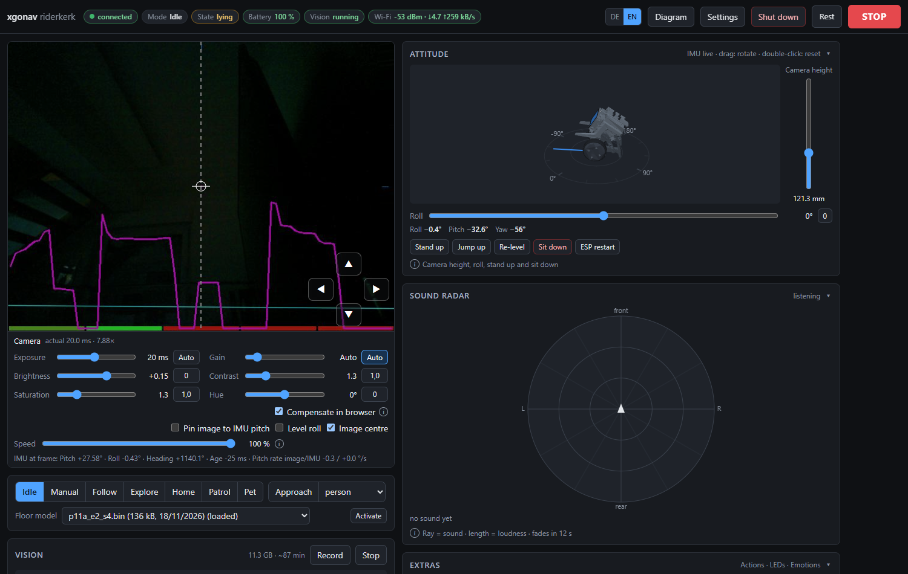

# xgo_motorcortex2

Kernel driver, display daemon, camera navigation (**xgonav**) and web UI for the **XGO RiderPi**:
a self-balancing two-wheel robot with a Raspberry Pi CM4 (2 GB), an OV5647 wide-angle camera and an ESP32 motor controller.

## What it does

| Part | Function |
|---|---|
| Kernel driver `xgo-drv` | talks to the ESP32 over UART, exposes `/proc/XGORider/*` (drive, height, IMU, wheels, LEDs, actions) |
| xgonav | camera pipeline: ego-motion, floor boundary (FloorNet), local map, room map, behaviours (follow, explore, home, patrol, pet) |
| Web UI | nginx + PHP on the Rider: live camera, manual driving, 3D attitude, room map, settings |
| Display daemon | eyes and emotions on the 320×240 LCD |
| Firmware | ESP32 firmware R-1.1.6 plus own patches, built with PlatformIO |

Design rule: **CPU time on the Rider comes first.** Everything that only serves display or comfort runs in the browser or on the PC, never per frame on the CM4.

## Test status

!!! warning "Not a finished product"
    One device, one developer. Driven on the Rider: manual driving, `follow`, `home` (with start image check).
    `explore` ran three times and **has no fall protection: it nearly drove down a step**. `approach` and `pet` have only run in the simulator.
    Never run an autonomous mode near stairs. Details: [Limitations](limitations.md).

## Where to go

| I want to … | Read |
|---|---|
| install everything on a Rider | [Install](guide/install.md) |
| drive it for the first time | [Quick start](guide/quickstart.md) |
| understand the web UI | [Web UI](guide/web.md) |
| know what each mode does | [Behaviours](guide/behaviours.md) |
| train my own floor network | [FloorNet training](guide/advanced/floornet-training.md) |
| develop without hardware | [Simulator and tests](guide/advanced/simulator.md) |
| look up a parameter | [Configuration](configuration.md) |
| understand the data flow | [Architecture](architecture.md) |

Source: [github.com/aeinstein/xgo_motorcortex2](https://github.com/aeinstein/xgo_motorcortex2).
