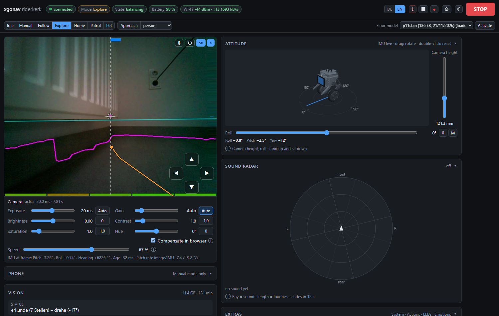

# Web interface

| Item | Value |
|---|---|
| URL | `https://<rider>/` (port 80 redirects here; old `/xgonav/…` paths are rewritten internally) |
| Stack | nginx (TLS on 443) → php-fpm pool `xgonav` → `web/index.php`, `web/api.php` |
| Backend | xgonav local API `127.0.0.1:8088` (`output.web_host`, `web_port`) |
| Auth | **none** — LAN only |
| Installed to | `/opt/xgonav/web/` |
| LLM access | `https://<rider>/mcp.php` → [MCP server](mcp.md) (`web/mcp.php`), level in `/etc/xgonav/mcp.json` |
| Static pages | `https://<rider>/geschichte/` → `web/geschichte/` (project story, one chapter per page, nginx only); `https://<rider>/anleitung/` → `web/anleitung/` (this manual, built on the PC by `tools/build_manual.sh` from `docs/` with MkDocs Material, committed, nginx only) |

## Layout (`web/index.php`)

| Area | Content |
|---|---|
| Header (fixed, page padded by its measured height) | host, connection, mode, state (firmware `state`: balancing / lying = set down (254) / fallen (0) / ready (253) / battery low / actuator fault / fault; mapped in the browser), battery (green ≥ 40 %, yellow ≥ 20 %, red < 20 %), recording (only while switched on), WLAN (signal dBm: green ≥ −60, yellow ≥ −70, red below; ↓/↑ kB/s of `wlan0`), language DE/EN, **⤓** Absetzen (254, shown while balancing, fallen (0) or armed and ready (253)), **⤒** Aufspringen (253, confirm) and **↑** Aufstehen (arm, 255) (both shown only while lying; all three without connection; header buttons are icon only), pipeline start/stop (icon ▶/■), **Aufzeichnen** (icon ●, red; white on red while recording; raw recording, only shown with `rawrec`), **⚙** Einstellungen (always icon only; modal, see below), **☾** Ruhe (icon only), **STOPP**; second header row: mode selector, target class and *Bodenmodell* (described under Left) |
| Left | camera image (WebSocket) with camera bar below it: exposure (ms, auto), gain (1–63.9×, auto), icon toggles at the top right of the image (overlay, blue = on): **⇕** *Bild am IMU-Nick festhalten* (browser shifts the `` by `row_stand − row_imu` minus its running mean (~3 s) via CSS, so only the pitch oscillation is removed and the image fills the frame on average, no pipeline cost; stored in `localStorage`; normal pose against the pure IMU pitch without image share); **⟲** *Roll ausgleichen* (browser rotates the `` by the IMU roll about the horizon point at `cx`; vertical edges stand vertical if the roll is right; `localStorage` `xgonav.roll`), **↝** *Planerbahn* (browser projects the planner path `/status` → `plan` (map coordinates) onto the image: pinhole over the floor plane with `kamera` (f, `cam_h_m`, `cam_fwd_m`) from `/status`, pose and horizon row from the `nick=3` header, roll about (`cx`, horizon row) like `freespace.roll_columns`; segments behind the camera are clipped, end point as dot; orange; default on, `localStorage` `xgonav.plan`; no pipeline cost, `/status` +plan points at 1 Hz (plus `erwartet` [x, y]: expected position of a lost target, or null), `/ws` +16 bytes and one lock per frame), **⌖** *Bildmitte* (browser draws the configured image centre over the `` as SVG: dashed column `cx` = W/2 (driving direction, mounting yaw is in the lens table) from the frame header, circle at row H/2; follows both CSS transforms; default on, `localStorage` `xgonav.mitte`; no pipeline cost), actual values (help in the ⓘ tooltip); mode selector (Idle · Hand · Follow · Explore · Approach · Zum Start) + target class dropdown (classes from `?a=detector`, reloaded after an xgonav restart, last choice in `localStorage`; disabled when YOLO is off), pipeline card with recording status, free space and status tiles, *Bodenmodell* dropdown + *Aktivieren* (nets from `?a=floornet`, loaded once per page and after a restart or switch; disabled while `net` is not a symlink) |
| Lage (open by default, right column top) | 3D model of the Rider rotated by roll, pitch, yaw from `imu_log`: CAD model `web/rider-model.bin` via WebGL, legs follow the `height`/`roll` setpoints through the linkage, smoothed ~0.33 s, at minimum while state = 254 (sliders keep their value), see limitations; wheels turn by the encoder ticks from `wheels_log` (1024/rev, live packet `imu.wheels`, CAD model only) (built by `tools/step_to_model.py` from `docs/Rider-Pi.STEP`, loaded when Verlauf is first opened); without WebGL or the file, simple boxes on canvas 2D; fixed compass ring on the ground (0° = heading at ESP32 start, + = left), blue line = body forward direction; values below. Samples replayed smoothly ~0.4 s behind; rotation about the wheel axle. Drag (mouse/touch) to orbit the view (elevation 5–85°), double-click resets; view kept in `localStorage` `xgonav.lage3d`; live (5 s buffer, memory); open/closed kept in `localStorage` `xgonav.lage`. Controls: vertical *Kamerahöhe* slider beside the model (shows the camera height the floor geometry uses, in mm, from `cam_h_gerade`, including the × 0.921 correction, so about 8 % below a folding-rule reading; writes u8 61–205, u8 in the tooltip; shows `u8 …` until xgonav has answered once), roll −20..20° below |
| Fahren | D-pad; speed 25/50/75/100 % in the mode bar after Approach (too narrow: it moves behind the floor model instead of pushing that down; the header title hides when the first row or the status pills wrap, measured in the browser); *Lage*: ⚖ Neu ausrichten (leveling pulse) next to the roll 0 button; *Extras* card (collapsed, open/closed in `localStorage` `xgonav.extras`): **Anleitung** (opens `anleitung/index.html`, static), **Schaubild** (opens `schaubild.html`, static, no cost on the Pi), **ESP-Neustart** (237, firmware patch 0018, only while not balancing), **Herunterfahren** (confirm dialog), actions 1–6, 4 LEDs + all off + strobe, brightness slider (persistent), display emotions |
| Raumkarte | room map PNG, view 3/6/10/16/24 m; mouse: drag to pan, wheel to zoom about the pointer (1 m..`grid.size_m`), double-click recentres on the Rider and follows again (touch: page scrolls, no pan). Buttons in three fixed groups: *Karte* (Speichern, sperren/entsperren, Zurücksetzen with confirm), *Start · Pose* (Start hier, Pose verwerfen: only with `reloc`, disabled while the pose is unknown), *Route · Zonen* (Route setzen, Sperrzone, Zonen löschen). Editing bar and pose warning are overlays on the map (top/bottom), groups are disabled while editing; nothing shifts the layout. Status: pose line with distance to start, one reserved line for explore/patrol. Below: start image (anchor of the start image check, `/startbild.jpg`, reloaded only for a new anchor; hidden after set-down or with unknown pose) |
| Verlauf (collapsed) | history charts, see below |
| Samples (collapsed, after Schallradar) | voice samples of `pet` from `[stimme] dir`: learned (NN, 📌 protect/release (uploaded start protected), length, times heard, last heard; ▶ parrot version / raw in the browser, 🔊 on the Rider, ✕ delete with confirm), upload (file → 16 kHz mono ≤ 3 s in the browser → `api.php?a=stimme_hochladen`; *already edited*: 48 kHz ≤ 8 s, no filter) and candidates (▶, ✕); list via `api.php?a=stimmen` only when opened or on Reload, playback in the browser (`<audio>`), open/closed in `localStorage` `xgonav.samples` |
| Gesichter (collapsed, after Samples) | learned faces of `pet` from `[gesicht] dir` ([faces.md](faces.md)): per name the aligned crops (✕ per photo, ✕ per name with confirm) and the greeting (emotion + sound or voice sample + eye colour, default/none → `api.php?a=gesicht_gruss`); upload: name + photos, shrunk to ≤ 1024 px JPEG in the browser → `api.php?a=gesicht_hochladen`; **Anlernen** → `api.php?a=gesicht_anlernen` (progress from the live status, Cancel), ✎ per name → `api.php?a=gesicht_umbenennen`; list via `api.php?a=gesichter` only when opened or on Reload; open/closed in `localStorage` `xgonav.gesichter` |

Language: German is in the HTML, English in the dictionaries `EN`/`EN_HTML` of `index.php` (keyed by the German text; long help blocks via `data-i18n-html`). Switched in the browser only, choice in `localStorage` `xgonav.lang`; free text from xgonav/`api.php` (status, errors) stays German. `?i18n=debug` logs missing translations to the console. No cost on the Pi.

Live data: one WebSocket `/live` (see below) instead of polling; HTTP `a=status` only at load and after
commands. Map every 1 s (next request after previous finished).

## Einstellungen (settings modal)

| Item | Value |
|---|---|
| Fields | all of `xgonav/config.py` (402), categories Hardware · Wahrnehmung · Karten · Verhalten · Ausgabe → TOML sections; help text = comments from `config.py` |
| Schema | `web/config-schema.json`, generated on the PC by `python tools/config_schema.py`; `test_config_schema_aktuell` fails if stale |
| Editing | line-based: only changed lines rewritten, indentation and comments kept; new keys appended to their section with `# Web <date>`; *Default* removes the line. Multi-line values: read-only (ssh) |
| Check | browser (type), PHP (schema type), `Config.load` (same as service start) |
| Backup | before every write: `/var/lib/xgonav/config-backup/config.toml.<stamp>`, last 50 kept, restore from the modal |
| Takes effect | after restart of xgonav (button *Neu starten* / *Speichern und neu starten*) |
| Rights | `config.toml` group `video`, 0664 (`deploy/install.sh`); sudoers `deploy/sudoers-xgonav-restart` |
| Pi cost | none in the pipeline; per save one Python start (~50 ms) |

## History (Verlauf)

Canvas, no library; crosshair + values on hover/touch (charts). Data comes from `/proc` via PHP and
works without xgonav.

| Chart | Data | Window | Storage |
|---|---|---|---|
| CPU | load per core (%) from `/proc/stat` deltas × cur/max clock (% of max clock); temperature, clock (cur/max MHz) + loadavg in heading | 10 min | memory |
| WLAN | ↓/↑ kB/s from `wlan0` byte-counter deltas, signal dBm (−90…−30), quality /70 in heading; from live packet field `sys.wlan` (1 Hz, also in a hidden tab) | 10 min | memory |
| Akku | battery % (from status or `sys`), ≤ 1 point / 30 s | 120 min | `localStorage` `xgonav.akku`; button Leeren |

- Battery is recorded while the page is open, also with the card collapsed. A second open tab merges into the same key.
- Open/closed state is kept in `localStorage` (`xgonav.verlauf`).
- Sign convention as firmware: roll + = right side down, pitch + = nose down, yaw + = left. When seq goes backwards (driver reloaded), the buffer is cleared. Animation runs only while the card is open and the tab is visible.

## Manual driving

- Hold button / pointer / arrow keys / WASD. Switches to mode `manual` automatically.
- Setpoint sent every 200 ms; xgonav stops after 0.5 s without setpoint.
- Limited to `robot.max_v` / `max_w`.
- No floor model, no arc check; fall detection and watchdogs active.
- Works with pipeline stopped (no camera, ~no CPU).
- Window blur releases all keys.

## `api.php`

GET only for `status`, `route`, `detector`; all commands POST. Parameters are validated; invalid → HTTP 400.

Environment (unset on the Rider; set by the php-fpm pool of the virtual Rider, `tools/sim_rider.fpm.conf`):

| Variable | Default | Meaning |
|---|---|---|
| `XGO_NAV` | `http://127.0.0.1:8088` | xgonav base URL |
| `XGO_PROC` | `/proc/XGORider` | driver directory (`height`, `roll`, `action`, `leds/*`, `settings/*`) |
| `XGO_SIM` | – | `1`: `shutdown`, `restart`, `wlan_*`, `emotion`, `config_save`, `config_restore` → 409; sleep mode skips `xgo-ruhe` |

| Request | Target | Range |
|---|---|---|
| `GET ?a=status` | xgonav `/status` (once; live via `/live`) | |
| `GET ?a=detector` | xgonav `/detector` | JSON `on`, `geladen`, `backend`, `classes`, `modes`, `default` |
| `GET ?a=floornet` | xgonav `/floornet` | JSON `modelle` (`name`, `kb`, `zeit`), `aktiv` (symlink target), `geladen`, `ist_link`, `ordner`, `blind`, `modes` |
| `POST ?a=floornet&name=x.bin` | xgonav `/floornet` (timeout 20 s) | name `[A-Za-z0-9_.+-]{1,80}\.bin` |
| `POST ?a=mode&name=..&target=..` | xgonav `/mode` | name ∈ idle, manual, follow, explore, approach, home, patrol, pet; target `[a-z ]{1,30}` |
| `POST ?a=stop` | xgonav `/stop` | |
| `POST ?a=pipeline&on=0\|1` | xgonav `/pipeline` | |
| `POST ?a=ruhe&on=0\|1` | xgonav `/ruhe` + emotion `sleep` (on only) + `sudo -n /usr/local/sbin/xgo-ruhe on\|off` | always 200; JSON `ok`, `ruhe`, `xgonav`, `system`, `fehler` (both parts are tried even if one fails) |
| `POST ?a=record&on=0\|1` | xgonav `/record` | |
| `POST ?a=ausrichten` | xgonav `/level` | 409 if not balancing |
| `POST ?a=drive&v=..&w=..` | xgonav `/drive` | −1..1; mode `manual` only |
| `POST ?a=exposure&us=..` | xgonav `/exposure` | 0 = auto, 100..frame period (`max_us` in `/status`, checked by xgonav) |
| `POST ?a=gain&g=..` | xgonav `/gain` | 0 = auto, 1..63.9 |
| `POST ?a=map_reset` | xgonav `/map/reset` | |
| `POST ?a=map_start` | xgonav `/map/start` | |
| `POST ?a=map_save` | xgonav `/map/save` | |
| `POST ?a=map_pose&aktion=start\|hier\|verwerfen` | xgonav `/map/pose` | confirm or discard the pose in the room map (`[reloc] enabled`) |
| `POST ?a=led&i=0..3&c=%23rrggbb` | `/proc/XGORider/leds/<i>` | |
| `POST ?a=led_brightness&p=0..100` | `/var/lib/xgonav/led_brightness`, then `/proc/XGORider/settings/led_brightness` | percent → n = p·255/100; persistent, set at boot (`rc.local`) and on xgonav start |
| `POST ?a=action&n=..` | `/proc/XGORider/action` | 1..6, 237, 253, 254, 255; 254 and 237 (ESP32 restart) first call xgonav `/stop?nur=pet` (ends mode `pet`, so it cannot stand up by itself); 3..5 drive/turn by themselves and go to xgonav `/action` instead (409 with reason), directly to `/proc` only if xgonav is not running |
| `POST ?a=height&h=..` | `/proc/XGORider/height` | 61..205 |
| `POST ?a=roll&deg=..` | `/proc/XGORider/roll` | −20..20 |
| `POST ?a=calibration&on=0\|1` | `settings/calibration` | API only, no UI button |
| `POST ?a=pitch_calibration` | `settings/pitch_calibration` | API only, no UI button |
| `POST ?a=emotion&name=..` | `tools/emotion.sh play NAME` | name must be in `/tmp/lcd0.augen.namen` (eye generator of the display daemon) |
| `POST ?a=shutdown` | plays `sleep` emotion, `sudo systemctl poweroff` | |
| `GET ?a=wlan_status` | `sudo -n xgo-wlan status` | JSON `con`, `ssid`, `ip` of wlan0; in the hotspot also `clients`, `letzt` |
| `GET ?a=wlan_scan` | `sudo -n xgo-wlan scan` | JSON `netze` [`ssid`, `signal`, `security`], cached scan |
| `POST ?a=wlan_connect` | `sudo -n xgo-wlan connect` (password via stdin) | body JSON `{ssid, pw}`; pw 8..63 or empty (open); over the hotspot: answers at once (`hotspot: true`); on failure the hotspot comes back, `letzt` holds the error |
| `POST ?a=wlan&on=0\|1` | xgonav `/wlan` | Wi-Fi setup like buttons C+D (QR code only) |
| `GET ?a=config` | schema `web/config-schema.json` + values parsed from `/opt/xgonav/config.toml` + backups | JSON `schema`, `werte`, `unlesbar`, `hash`, `schreibbar`, `sicherungen` |
| `POST ?a=config_save&hash=..` | rewrites changed lines of `config.toml` | body JSON `{"section.key": value\|null}` (null = remove line → default; top level: `allgemein.control_hz`); type-checked against schema, then `Config.load` via `/opt/xgonav/venv/bin/python`; 409 if file changed since `hash` |
| `POST ?a=config_restore&name=..&hash=..` | copies a backup back | name `config.toml.YYYYMMDD-HHMMSS[-n]` |
| `POST ?a=restart[&trotzdem=1]` | `sudo -n systemctl --no-block restart xgonav` | 409 in Ruhe (always) or while mode ≠ idle / balancing / recording (unless `trotzdem=1`) |

xgonav unreachable → HTTP 502 `xgonav nicht erreichbar`. Exposure/gain changes last until xgonav restarts.

## xgonav local API (`xgonav/web.py`)

| Method | Path | Response / effect |
|---|---|---|
| GET | `/status` | JSON (mode, pipeline, status, cmd, tracks, free, ttc, fps, loop_ms, loop_p95, loop_max, det_ms, grid, exposure, battery, balancing, state (firmware state, see `driver.md`), yaw_imu (heading in degrees from the IMU stream, all turns summed, not wrapped), height_mm, height_u8, cam_h_mm, cam_h_gerade `[a, b]` (mm = a + b·u8), pitch_src, pitch_deg, ego, odom, …); `?breakdown=1` adds per-section loop timing |
| GET | `/ws` | WebSocket, overlay JPEGs; `?nick=2`: per-frame IMU values in the header (`ws_kopf`, see Image transport); `?nick=3` (used by `index.php`): plus horizon row and map pose |
| GET | `/frame?after=<idx>` | single JPEG newer than idx |
| GET | `/startbild.jpg` | start image (anchor) as JPEG, encoded once per anchor; 404 without anchor |
| GET | `/map.png?px=480&view=6[&cx=&cy=]` | room map; px 120..960, view 1..`grid.size_m`; centre `cx`,`cy` in map metres (both or neither; default Rider pose; clamped to ±`grid.size_m`); header `X-Map-View: cx,cy,view,size`; 404 if no map |
| POST | `/mode?name=..&target=..` | 400 unknown mode, 409 not allowed |
| POST | `/stop` | standstill, mode idle; aborts a running firmware action 3..5 |
| POST | `/action?n=3\|4\|5` | firmware action that drives (3, 4) or turns (5): keepalive and kernel watchdog off for its duration (`[robot] action_tick_s`), every control step checks its current and upcoming segments with `safety()` and the arc check, any reduction aborts (128/128 every 20 ms until its planned end). 409: not mode idle, not balancing, sleep mode, action running; 3/4 also without image processing or floor boundary. A blocked path at start is reported in `/status` `status` only |
| POST | `/pipeline?on=0\|1` | stop/start image processing; 409 in sleep mode |
| POST | `/ruhe?on=0\|1` | sleep mode on/off; `/status` field `ruhe` |
| POST | `/wlan?on=0\|1` | start/cancel Wi-Fi setup ([wifi-setup.md](wifi-setup.md)); `/status` field `wlan` (`state`, `text`, `detail`, `ssid`, `ip`, `hotspot`) or null. `/status` field `ortung` (sound direction, [audio.md](audio.md#sound-direction-xgonavortungpy)): `aktiv`, `kern`, `fehler`, `n`, `schwach`, `letzter` or null, `verlauf` (≤ 12 sounds of the last 15 s as `[age s, angle °, quality, level dB]`). Card **Schallradar** draws them as rays (up = front, dashed twin to the rear because front/back cannot be told apart, length = level, fading over 12 s; rays and spokes are counter-rotated by the IMU yaw since each sound, so they keep pointing at the source while the Rider turns; the card requests the IMU samples of the live packet itself, also with Lage closed); drawn in the browser only while the card is open, no extra request (data from the 1 s live packet) |
| POST | `/record?on=0\|1` | switch raw recording; `/status` field `aufzeichnung`: `an`, `laeuft`, `ordner`, `bilder`, `fehler`, `frei_mb` (free down to `record_min_free_mb`, statvfs at most every 2 s), `rate_mb_s` (measured in the last recording, else estimate 2.2), `rate_gemessen`; the web view shows free space and remaining minutes left of the button |
| POST | `/level` | leveling pulse (roll 0, 3 s `roll_balance`); 409 if not balancing |
| POST | `/turn?deg=..&w=0.5&tol=3` | mode `manual`, balancing only (409 otherwise, 400 outside deg ±1080, w 0.05..1, tol 1..10): turn on the spot by `deg` (+ = left), rate `behavior.turn_to_kp` × remaining angle via `behaviors.dreh_auf_kurs`, at most `w` × `max_w`; time limit (10 s + 1 s per 20°) / `tempo`. Progress in `/status` `turn` (`soll_deg`, `gedreht_deg`, `fertig`, `grund`: `angekommen`, `Zeit abgelaufen`, `abgebrochen`, `liegt`, `kein Kurs`), overshoot counted for `turn_settle_s`; any `/drive` cancels. Used by MCP `drehen`/`rundblick` and `rider_nav.py dreh` (2026-11-23) |
| POST | `/bahn?laenge=3&winkel=20&welle=1.5&zurueck=1&v=0.3&kurve=1` | mode `manual`, balancing, pipeline and room map with known pose (409 otherwise; 400 outside laenge 0.2..6 m, winkel 0..45°, welle 0.3..6 m, v 0.05..1 = factor of `max_v`, default `home.v`; `kurve=0` without the curve speed limit `home.kurve_a_mps2`, for lean tests): fixed test path from the current pose, snake y = A·sin(2πx/welle) with at most `winkel` against the heading, points every 5 cm; driven by the path follower like `explore`/`home` (checked: `safety()` + arc check, braking only for curves, path end, obstacles), at the end hold 1 s, with `zurueck` turn 180° on the spot and drive the same path back. Progress in `/status` `bahn` (`phase` hin/halt/wenden/zurueck/fertig, `fertig`, `grund`: `angekommen`, `festgefahren`, `abgebrochen`, `liegt`); any `/drive` or `/turn` cancels (2026-11-26) |
| POST | `/drive?v=..&w=..[&sicher=1]` | 409 if not mode `manual`; `v`, `w` −1..1 are factors of `robot.max_v`/`max_w` (sent v · `tempo` · `max_v`; D-pad sends ±1); `sicher=1` (used by the [MCP server](mcp.md)): this setpoint passes `safety()` and the arc check like the autonomous modes; with the pipeline stopped it only turns |
| POST | `/exposure?us=..`, `/gain?g=..` | 400 if out of range |
| POST | `/bild?k=0.5..4&s=0.5..4&b=-0.5..0.5` | contrast/saturation/brightness in the camera ISP (`b` optional; also reaches FloorNet and recordings; `meta.jsonl` `cam.contrast`/`saturation`/`brightness`), until restart; `/status` `exposure.contrast`/`saturation`/`brightness`; the web view can compensate with an SVG filter (checkbox, stored in the browser). Camera sliders (exposure, gain, brightness, contrast, saturation, hue) sit in a collapsible „Kamera“ panel below the image (open state stored in the browser); hue is display-only (SVG filter) |
| POST | `/tempo?f=0.05..1` | speed slider: factor for all drive/turn commands of all modes (after `max_v`/`max_w`), until restart; `GET /status` → `tempo` |
| POST | `/pursuit?on=0\|1` | drive style *Pursuit* (checkbox right of the speed slider, not a mode), until restart: accel/decel/brake × `robot.pursuit_accel_faktor` (1.5), leveling with curve lean (action 232), body height falls linearly with speed down to camera height `robot.pursuit_kamera_min_mm` (110 mm) at `v_max`; off: normal ramps, leveling and lean off (231, unless `level_always`), height back; `GET /status` → `pursuit` |
| POST | `/map/reset` | clear room map, pose = start = 0 |
| POST | `/map/start` | start point = current pose |
| POST | `/map/save` | save now to `grid.file`; 404 if no map or no file |
| POST | `/map/pose?aktion=start\|hier\|verwerfen` | `start`: Rider stands on the start point, pose jumps there; `hier`: shown pose is right; `verwerfen`: pose unknown (needs `[reloc] enabled`). 409 while lying, during `home`/`patrol`/`explore` |
| GET | `/detector` | selectable targets (detector classes), computed on request only |
| POST | `/stimme/spielen?name=NN` | play learned voice sample NN on the speaker (`Emotions.sound("stimme:NN")`); 404 without `[stimme]` or file. Card **Samples** ([audio.md](audio.md#voice-samples-xgonavstimmepy-mode-pet)) |
| POST | `/stimme/fest?name=NN&an=0\|1` | protect a confirmed sample (never replaced) or release it, `fest.json`; 400 bad name, 404 missing |
| POST | `/stimme/loeschen?name=NN\|<time>` | delete a learned sample or candidate (files, memory, `zaehler.json`, `fest.json`); 400 bad name, 404 missing |
| POST | `/stimme/hochladen?fertig=0\|1` | body WAV mono int16, 16 kHz (filtered) or with `fertig=1` 48 kHz (stored unchanged), ≤ 1000 KB: queue as fixed confirmed sample → `{ok, name, ersetzt}`; 400 bad WAV/rate, 409 all slots uploaded, 413 empty/too large, 404 without `[stimme]` |
| GET | `/gesicht` | face recognition: `on`, names with photo count, `gruesse` (greeting per name), `ms` per check ([faces.md](faces.md)) |
| POST | `/gesicht/hochladen?name=..` | body JPEG/PNG ≤ 4 MB: learn the largest face → `{ok, name, nr, jpg}` (aligned crop, base64); 400 no face/bad name/image, 413 empty/too large, 404 recognition off |
| POST | `/gesicht/loeschen?name=..&nr=NN` | delete one photo (without `nr`: all of the name); 404 missing |
| POST | `/gesicht/anlernen` | mode `anlernen`: learn the person in front of the camera as `PersonN` ([faces.md](faces.md)); `?stop=1` cancels; progress/result in `/status` → `anlernen`; 409 not allowed |
| POST | `/gesicht/umbenennen?name=..&neu=..` | rename a learned name; existing `neu`: merge photos (≤ 50), greeting of `neu` stays; memory entry and tracks follow; 400 bad/unknown name or too many photos |
| POST | `/gesicht/gruss?name=..&emotion=..&sound=..&augen=..` | greeting of a learned name (empty = `[pet] greet_*`/turquoise, `-` = none, sound also `stimme:NN`, `augen` = `PALETTE` colour) → `{ok, gruss}`; 400 unknown name/bad value |
| GET | `/floornet` | `*.bin` in `[freespace] net_dir`, active (symlink `net`) and loaded net; one directory read on request |
| POST | `/floornet?name=x.bin` | switch floor model without restart: load + self-test in the web thread (old net keeps running), then repoint symlink `net` atomically, swap the net in `FreeSpaceWorker` (waits for a running inference), close the old one, floor boundary held `restart_hold_s`. Only in `idle`/`manual` (409), 409 if not loadable (old net stays), 400 for names outside `net_dir`, 500 if the symlink cannot be written |

Removed 2026-11-17: `/stream` (MJPEG), `/ws?nick=1`, `/horizon`, `/horizon/edit`, `/horizon/cal`, `/horizon/delete` and `api.php?a=horizon|horizon_edit|horizon_cal|horizon_delete`; `/status` has no `horizon` field any more, `pitch_src` is `"imu"` or `"bild"`.

Mode rules: `explore`/`approach`/`home` need `freespace.enabled` (else 409); `follow`/`approach` need a running detector and a target in its classes (else 409); `home` also needs the room map; all modes except `idle`/`manual` need a running pipeline (else 409).

## Image transport (WebSocket)

| Item | Value |
|---|---|
| Path | `/ws` (nginx → xgonav `/ws`, TLS terminates in nginx) |
| Message | binary: 4-byte frame index + JPEG; with `?nick=2` (header from `web.ws_kopf`): index, then 10 × float32 BE: `row_stand`, `row_imu` (`horizon_row(0)` / `horizon_row(pure IMU pitch)`; NaN = no IMU), roll (deg, + = right side low, as the cyan line), `cx`, IMU pitch (deg), IMU heading (deg), age of the IMU sample (ms), pitch rate from image and from IMU (°/s), state (1 = IMU valid, 0 = pitch from the image only, NaN = no IMU); then the JPEG. All from the snapshot, nothing computed anew. `?nick=3`: the same 10 values, then 4 × float32: horizon row at `cx` (as the cyan line), map pose x, y (m), th (rad) read at send time (NaN without room map) |
| Flow control | client sends `ok` per image; xgonav sends the next (newest) image only after ack |
| Ack timeout | 10 s → connection closed |
| Reconnect | client after 1 s |
| Pipeline state | client connects only while `pipeline` = `läuft` (and not sleep mode), closes otherwise; last image stays dimmed. xgonav sends an unchanged image once, no re-encode |
| Rate | ≤ `output.web_fps` (10) |
| Raw | `?roh=1`: camera image without overlay, JPEG quality 80 (overlay 70); combinable with `nick` |
| Overlay | no status text lines in web frames (~10 ms saved per image); drawing ~1 ms per sent image (RiderPi) |
| JPEG | hardware encoder `/dev/video31` (`jpeg.py`, `native/jpegfast.cpp`, `output.jpeg_native`), self-check at first image; fallback `cv2.imencode` (4.5 ms CPU per 640×480 image on the RiderPi); raw recording see below |

Replaced MJPEG (`/stream`, removed 2026-11-17): on weak Wi-Fi, TCP buffers queued up to 20 s of delay.

### OBS (`web/obs.php`)

| Item | Value |
|---|---|
| URL | `https://<rider>/obs.php?roh=1` (raw image), without `roh` with overlay as in the web view |
| OBS | source „Browser“, 640 × 480; self-signed certificate: start OBS with `--ignore-certificate-errors` |
| Page | image only on black (`object-fit: contain`), `/ws` with ack per image, reconnect after 1 s, last image stays when the pipeline is off |
| Cost on the Pi | like another open web tab: ≤ 10 JPEG/s in the hardware encoder; `roh=1` skips drawing the overlay |

## Live data (WebSocket)

Daemon `tools/live.php` (PHP CLI, unit `xgonav-live.service`, user `www-data`, `Nice=10`), not under `web/`
(would be callable via php-fpm). Reads `/proc` directly, works without xgonav. One shared read per tick for all tabs.

| Item | Value |
|---|---|
| Path | `/live` (nginx → `127.0.0.1:8089`) |
| Idle | no client: blocks in `stream_select`, no `/proc` reads, 0 % CPU |
| `sys` + `status`, 1 s (sleep mode 5 s) | `sys`: `t`, `cpu` `[[total, idle+iowait], …]` per core (jiffies), `temp_c`, `load`, `mhz` `[cur, max]` (cpu0 cpufreq) or `null`, `battery`, `height`, `roll`, `state`, `wlan` `"rx_bytes tx_bytes dBm quality"` (`-` = unknown); `status`: xgonav `/status` verbatim (timeout 0.5 s) or `null` + `status_fehler` |
| `imu`, 0.3 s if `state` = 1 (balancing), else 1 s; none in sleep mode | `seq`, `imu` `[[seq, t_ms, roll, pitch, yaw], …]` (°), `wseq`, `wheels` `[[seq, t_ms, ticks_left, ticks_right], …]`, `state`; only samples newer than the last sent per connection |
| Packing | `sys` and `imu` due together → one text frame `{"sys":…,"status":…,"imu":…}` |
| Client → server | `imu 0\|1 [since wsince]`: IMU on/off for this connection (Lage closed or tab hidden → 0); since/wsince after reconnect avoid duplicates |
| Reconnect | client after 1 s |
| Limit | `imu_log` holds 128 samples: at 1 s while lying, samples are skipped |
| Env (tests) | `XGO_PROC`, `XGO_LIVE_PORT`, `XGO_STATUS_URL` |

## Intercom (WebSocket)

Talk to the Rider from the browser, mode **manual** only. Collapsible card *Telefon* right below the camera image (closed by default, `localStorage` `xgonav.telefon`), button *Sprechen*; the heading shows the state.
Daemon `tools/sprech.php` (PHP CLI, unit `xgonav-sprech.service`, user `www-data` + group `audio`, `Nice=10`);
WebSocket helpers shared with `live.php` in `tools/ws.inc.php`.

| Item | Value |
|---|---|
| Path | `/sprech` (nginx → `127.0.0.1:8090`) |
| Rider → browser | `arecord -D plughw:CARD=wm8960soundcard,DEV=0 -f S16_LE -r 8000 -c 1`, binary frames of 640 B (40 ms); dropped while > 0.5 s unsent |
| Browser → Rider | binary frames S16_LE 8 kHz mono → `aplay -D plughw:CARD=wm8960soundcard,DEV=0`; backlog > 0.5 s cut to the newest 0.2 s |
| Server → client (text) | `{"sprech": "an"\|"aus", "grund": …}`, then close |
| Client → server (text) | `mic 0\|1` (send Rider microphone), `laut 0\|1` (speaker) |
| Admission | xgonav `/status` `mode == "manual"` and not sleep mode; one call at a time (second browser: busy) |
| End | browser closes, mode leaves manual or xgonav unreachable (checked every 1 s), `arecord`/`aplay` ends; then both processes are killed, `hw:CARD=wm8960soundcard,DEV=0` free for sound direction (retry ≤ `[ortung] retry_s` 10 s) |
| Idle | no call: no `arecord`/`aplay`, blocks in `stream_select`, 0 % CPU |
| Browser | `getUserMedia` (echo cancellation, noise suppression, AGC; needs HTTPS), AudioWorklet: 3.5 kHz low-pass (windowed sinc, Blackman, 127 taps, evaluated only at the 8 kHz output points; until 2026-11-21 a box filter that folded 4–24 kHz into the voice band) + decimation to 8 kHz, 400 Hz high-pass (Butterworth 4th order; the Rider speaker produces almost only harmonics below ~300 Hz: measured +16 dB at 150 Hz, +7 dB at 250 Hz over the fundamental), then gain to the Rider 100–1600 % (default 300 %, `localStorage` `xgonav.sprechhin2`) with a soft tanh limiter up to 0.9 (speaker measurements with the old class-D boost 4, which itself distorted; now boost 0, `docs/audio.md`); playback with 120 ms jitter buffer (> 0.4 s → cut to 0.12 s), linear upsampling, volume here 0–400 % (`localStorage` `xgonav.sprechlaut`) |
| Echo | the Rider's speaker reaches its own microphones (−17 dBFS), our voice returns after the round trip (~0.5–1.5 s: Wi-Fi, aplay/arecord buffers, jitter buffer). Browser-side echo gate: level envelopes of sent and received audio in 40 ms bins, every 1 s the best log-level correlation over 0–1.6 s delay votes into a decaying histogram, coupling = median received/sent. A Rider frame is cut to 5 % when we spoke loudly within ±240 ms of the estimated delay and it is not clearly louder (3×) than the expected echo (double talk passes); without an estimate the whole 0–1.7 s window after own speech. Until 2026-11-21 it dimmed only 300 ms after own speech, so most of the echo came through. Simulated only (`echo_sim`), not heard. Option *Drücken zum Sprechen* (talk button or space bar; Rider dimmed while held; `localStorage` `xgonav.sprechptt`) |
| Cost on the Pi | `arecord` + `aplay` (8 kHz mono, ALSA plug resampling) + PHP loop ≈ 25 wake-ups/s: ≲ 1 % of a core, only during a call; Wi-Fi 2 × 16 kB/s; nothing in xgonav |
| Limits | during a call other `aplay` sounds (web, `rc.local`) fail (device busy) |
| Camera → display | checkbox *Kamera senden* (only during a call), 5 (default)/10/15 frames/s (`localStorage` `xgonav.sprechfps`), mirrored preview; second WebSocket `/sprech?bild` (own TCP connection, audio not held up) |
| Display frame | browser crops to 320×240 (centre, unmirrored), converts to RGB565 LE, one binary frame of 153 600 B; sends only with `bufferedAmount` 0; other lengths dropped |
| Display write | PID into `/tmp/lcd0.owner`, wait 0.3 s (emotion player / `lcd.py` release the FIFO), open FIFO `r+` non-blocking, partial writes kept so frames stay whole; one frame in flight + newest waiting; owner `touch`ed per frame |
| Emotion meanwhile | foreign PID in owner: current frame finished, FIFO closed, frames dropped until owner empty, then taken over again |
| Display end | image socket closes or call ends: rest written (≤ 1 s), FIFO closed, owner cleared, emotion `cute` played |
| Server → client (image) | `{"bild": "an"\|"aus", "grund": …}`; refused without call, second image busy, no FIFO |
| Cost on the Pi (image) | raw frames, no decoding. Measured 2026-11-21 (% of a core): 5/s nginx 4.9, PHP 3.3, `st7789_server` 1.0 (≈ 9 %, Wi-Fi 0.75 MB/s); 10/s nginx 9.0, PHP 5.7, `st7789_server` 2.2 (≈ 17 %, 1.5 MB/s); nothing in xgonav |
| Env (tests) | `XGO_SPRECH_PORT`, `XGO_STATUS_URL`, `XGO_ARECORD`, `XGO_APLAY` (full command lines), `XGO_LCD_FIFO`, `XGO_LCD_ENDE` |

## Pipeline stop

`POST /pipeline?on=0`: camera stopped, no image processing, standstill, mode idle. CM4 CPU of the
service ~340 % → ~4 %. Web stays reachable. After start: drives only once a mode is chosen.
With full processing, the charging dock current is insufficient to charge.

## Sleep mode (Ruhe)

Header button **Ruhe** (with confirmation). Woken by **Wecken** in the web UI or by the [MCP server](mcp.md) (`ruhemodus`).

| Part | On | Wake |
|---|---|---|
| Rider | set down (action 254) if balancing | stays lying |
| xgonav | pipeline off, mode idle, raw recording off; `imu`, `wheels` threads idle; `robot` thread reads state/battery every `ruhe.tick_s` (1 s), no keepalive; no LCD, no emotions, no WebSocket re-encode; pipeline and modes other than idle → 409 | threads resume; pipeline stays off |
| Driver (`settings/`) | `imu_hz`, `imu_stream_hz` → 0, `sleep_ms_on_loop` → `ruhe.sleep_ms_on_loop` (1000); old values kept in memory | old values written back |
| CPU (`xgo-ruhe`, root) | governor saved to `/run/xgo-ruhe.gov`, all cores `powersave` | saved governor (fallback `ondemand`) |
| Wi-Fi (`xgo-ruhe`, root) | `iw dev wlan0 set power_save on` | `power_save off` (also default via `/etc/NetworkManager/conf.d/xgonav-wifi-powersave.conf`; with power save ping 535 ms avg / 1.5 s max, without 20 ms, 2026-11-18) |
| Display (`api.php`) | plays `sleep` (~4 s, before the governor change); last frame (closed eyes) stays | unchanged until xgonav or an emotion writes the next frame |
| Page | cover with Wecken + battery; image WebSocket closed, no map polling; live packet every 5 s without IMU | normal rates |

- The display stays on: it cannot be switched off (DISPOFF + SLPIN via SIGUSR1 to `st7789_server` is no longer sent; `xgo-ruhe off` still sends SIGUSR2). Backlight (GPIO0 per `constants.h`) is not switched; untested.
- `POST ?a=ruhe&on=1` returns after the animation (~4 s).
- The ESP32 keeps running (control loop, BLE, amber LEDs).
- If xgonav restarts during sleep mode, the governor stays `powersave` until **Ruhe** + **Wecken**.
- If NetworkManager reconnects during sleep mode, Wi-Fi power save is off again (NM setting).

## Raw recording (`xgonav/rawrec.py`)

| Item | Value |
|---|---|
| Writes | JPEG (quality 92) + `meta.jsonl` per frame, format for `tools/replay_raw.py` and `tools/floornet/` |
| Target | `output.record_dir/YYYYMMDD-HHMMSS` (default `~/fahrt`, as service user) |
| JPEG | hardware encoder q95 (`output.record_jpeg_q_hw`), fallback libjpeg q92; `meta.jsonl` `"jpeg"` per image (since 2026-11-19) |
| Map images | every `output.record_map_s` 2 s (0 = off): room map with local-map points as `karte/<idx>.png` (`record_map_px` 480, `record_map_view_m` 6 m around the pose; same picture as `/map.png`), `idx` = JPEG taken at that moment. ~10 ms per image in the recording thread (since 2026-11-24) |
| Condition | switch on, state = balancing, pipeline running; only frames newer than the start |
| Set down | closes the recording; switch stays on, next stand-up starts a new subdirectory, no empty directories |
| Off by itself | service restart; free space < `output.record_min_free_mb` or write error (reason shown next to the button) |
| Cost on the Pi | off: no thread. On, lying: 5 attribute reads/s. Recording: one JPEG per frame in its own thread on `render_cpus`, never in the main loop; frames are skipped if it falls behind (gaps in `idx`); plus one map PNG every 2 s |

## Overlay colours

| Colour | Meaning |
|---|---|
| magenta | floor boundary from FloorNet, mapped onto the shown frame |
| cyan | horizon from the IMU pitch of the frame (rolled by the IMU roll) |
| bottom bars | free space per sector |
| red | target track |
| violet | image motion |
| blue | drive command |

## Route, no-go zones, patrol

| Control | Effect |
|---|---|
| Route setzen | click points on the map, optional loop, `POST api.php?a=route&pts=x,y;x,y&loop=0\|1` |
| Sperrzone | click at least 3 corners, added to the existing zones (`zones=x,y;x,y;x,y\|...`) |
| Zonen löschen | `nozones=1` |
| Karte sperren | `POST api.php?a=map_lock&on=0\|1` |
| Streife | mode `patrol` after a confirmation dialog (`bestaetigt=1`) |

Coordinates are metres in the map frame (top = +x, left = +y). `GET api.php?a=route` returns points, loop, zones, `map_id`.
