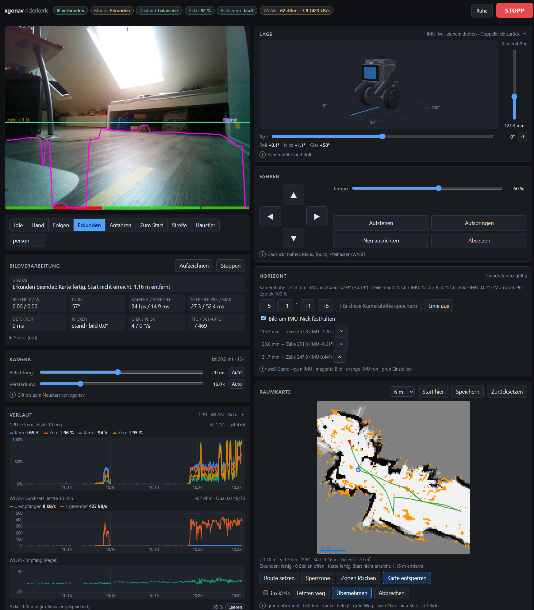

# Web interface

| Item | Value |
|---|---|
| URL | `https://<rider>/xgonav/` (`/` and port 80 redirect here) |
| Stack | nginx (TLS on 443) → php-fpm pool `xgonav` → `web/index.php`, `web/api.php` |
| Backend | xgonav local API `127.0.0.1:8088` (`output.web_host`, `web_port`) |
| Auth | **none** — LAN only |
| Installed to | `/opt/xgonav/web/` |

## Layout (`web/index.php`)

| Area | Content |
|---|---|
| Header (sticky) | host, connection, mode, state (balancing/lying), battery (green ≥ 40 %, yellow ≥ 20 %, red < 20 %), pipeline, **STOPP** |
| Left | camera image (WebSocket), mode selector (Idle · Hand · Follow · Explore · Approach · Zum Start) + target class, pipeline card with start/stop and status tiles, raw status JSON |
| Fahren | D-pad, speed 5–100 %, height 43–255, roll −20..20°, Aufstehen (arm, 255), Absetzen (disarm, 254) |
| Raumkarte | room map PNG, view 3/6/10/16 m, Start hier (start = pose), Speichern, reset, pose line with distance to start |
| Kamera | exposure (ms, auto), gain (1–16×, auto), actual values |
| Extras (collapsed) | actions 1–6, 4 LEDs + all off + strobe, display emotions |
| System | shutdown (confirm dialog) |

Polling: status every 700 ms, map every 1 s (next request after previous finished).

## Manual driving

- Hold button / pointer / arrow keys / WASD. Switches to mode `manual` automatically.
- Setpoint sent every 200 ms; xgonav stops after 0.5 s without setpoint.
- Limited to `robot.max_v` / `max_w`.
- No floor model, no arc check; fall detection and watchdogs active.
- Works with pipeline stopped (no camera, ~no CPU).
- Window blur releases all keys.

## `api.php`

GET only for `status`; all commands POST. Parameters are validated; invalid → HTTP 400.

| Request | Target | Range |
|---|---|---|
| `GET ?a=status` | xgonav `/status` | |
| `POST ?a=mode&name=..&target=..` | xgonav `/mode` | name ∈ idle, manual, follow, explore, approach, home; target `[a-z ]{1,30}` |
| `POST ?a=stop` | xgonav `/stop` | |
| `POST ?a=pipeline&on=0\|1` | xgonav `/pipeline` | |
| `POST ?a=drive&v=..&w=..` | xgonav `/drive` | −1..1; mode `manual` only |
| `POST ?a=exposure&us=..` | xgonav `/exposure` | 0 = auto, 100..33333 (checked by xgonav) |
| `POST ?a=gain&g=..` | xgonav `/gain` | 0 = auto, 1..16 |
| `POST ?a=map_reset` | xgonav `/map/reset` | |
| `POST ?a=map_start` | xgonav `/map/start` | |
| `POST ?a=map_save` | xgonav `/map/save` | |
| `POST ?a=led&i=0..3&c=%23rrggbb` | `/proc/XGORider/leds/<i>` | |
| `POST ?a=action&n=..` | `/proc/XGORider/action` | 1..6, 254, 255 |
| `POST ?a=height&h=..` | `/proc/XGORider/height` | 43..255 |
| `POST ?a=roll&deg=..` | `/proc/XGORider/roll` | −20..20 |
| `POST ?a=calibration&on=0\|1` | `settings/calibration` | API only, no UI button |
| `POST ?a=pitch_calibration` | `settings/pitch_calibration` | API only, no UI button |
| `POST ?a=emotion&name=..` | `tools/emotion.sh play` | name must exist in `rc_server/emotions` |
| `POST ?a=shutdown` | plays `sleep` emotion, `sudo systemctl poweroff` | |

xgonav unreachable → HTTP 502 `xgonav nicht erreichbar`. Exposure/gain changes last until xgonav restarts.

## xgonav local API (`xgonav/web.py`)

| Method | Path | Response / effect |
|---|---|---|
| GET | `/status` | JSON (mode, pipeline, status, cmd, tracks, free, ttc, fps, loop_ms, loop_p95, loop_max, det_ms, grid, exposure, battery, balancing, yaw_drv, pitch_src, pitch_deg, ego, odom, …); `?breakdown=1` adds per-section loop timing |
| GET | `/ws` | WebSocket, overlay JPEGs |
| GET | `/frame?after=<idx>` | single JPEG newer than idx |
| GET | `/stream` | MJPEG (legacy) |
| GET | `/map.png?px=480&view=6` | room map; px 120..960, view 1..`grid.size_m`; 404 if no map |
| POST | `/mode?name=..&target=..` | 400 unknown mode, 409 not allowed |
| POST | `/stop` | standstill, mode idle |
| POST | `/pipeline?on=0\|1` | stop/start image processing |
| POST | `/drive?v=..&w=..` | 409 if not mode `manual` |
| POST | `/exposure?us=..`, `/gain?g=..` | 400 if out of range |
| POST | `/map/reset` | clear room map, pose = start = 0 |
| POST | `/map/start` | start point = current pose |
| POST | `/map/save` | save now to `grid.file`; 404 if no map or no file |

Mode rules: `explore`/`approach`/`home` need `freespace.enabled` (else 409); `home` also needs the room map; all modes except `idle`/`manual` need a running pipeline (else 409).

## Image transport (WebSocket)

| Item | Value |
|---|---|
| Path | `/xgonav/ws` (nginx → xgonav `/ws`, TLS terminates in nginx) |
| Message | binary: 4-byte frame index + JPEG |
| Flow control | client sends `ok` per image; xgonav sends the next (newest) image only after ack |
| Ack timeout | 10 s → connection closed |
| Reconnect | client after 1 s |
| Rate | ≤ `output.web_fps` (10) |
| Overlay | no status text lines in web frames (~10 ms saved per image) |

Replaced MJPEG: on weak Wi-Fi, TCP buffers queued up to 20 s of delay.

## Pipeline stop

`POST /pipeline?on=0`: camera stopped, no image processing, standstill, mode idle. CM4 CPU of the
service ~340 % → ~4 %. Web stays reachable. After start: drives only once a mode is chosen.
With full processing, the charging dock current is insufficient to charge.

## Overlay colours

| Colour | Meaning |
|---|---|
| yellow | floor boundary per column |
| cyan | horizon (pitch-compensated) |
| bottom bars | free space per sector |
| red | target track |
| violet | image motion |
| blue | drive command |
